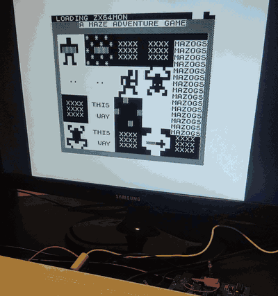

# zx64

**A ZX81 inside a Commodore 64. Well, inside its CP/M cartridge.**

The real Sinclair ZX81 ROM, running on the Z80 of Commodore's CP/M
cartridge. Not an emulator: the ROM's own code runs, with eleven routines
patched to use the C64's VIC, keyboard and disk drive; the 6510 handles
the disk. Plus a Supermon-style Z80 machine code monitor on F5.

<p align="center">
  
  <br><sub>On the real thing: the monitor loads, then F5 in and out of Mazogs. The LED shows which CPU has the machine.
  <a href="docs/img/demo.mp4">Full clip</a>.</sub>
</p>

## Quick start

Needs the CP/M cartridge on a [compatible C64](docs/manual.md#the-hardware),
with [one extra wire](docs/cpm-cart.md#the-int-wire), or VICE
(`x64sc -cpmcart`); your own ZX81 ROM; GNU z80asm, acme, c1541 (VICE)
and Python 3.

```sh
cp ~/somewhere/zx81.rom rom/
cp ~/somewhere/*.p games/       # optional
make                            # build/zx64.d64
```

On the C64: `LOAD "ZX81",8`, `RUN`. Then `LOAD "MAZOGS"`, as from tape.

## What you get

- The ZX81 in SLOW mode at about twice a real one's speed, 16K, 32K or
  1K, the picture through the VIC's raster interrupt.
- `LOAD` and `SAVE` from disk, with a progress bar.
- Type-ahead and the ZX81's layout on the C64 keyboard
  ([overlay](docs/img/keyboard.png), [to print](docs/keyboard.pdf)); F2 colour schemes; F7 reset, which
  repairs the ROM if a program wrote over it.
- zx64mon on F5: memory, disassembler, assembler, breakpoints, single
  step, disk and DOS commands, in any running program.
- `tools/pcheck.py`: warns about games that won't work, as they go on
  the disk.
- `make test`: both CPUs in emulators, with the real hardware's quirks
  modelled; 92 checks.

Not possible: hi-res, WRX and other display tricks.

## Documentation

- [The manual](docs/manual.md): background, how it works, using it, the
  monitor with examples, the test programs, troubleshooting.
- [The cartridge](docs/cpm-cart.md): what zx64 relies on, with sources;
  the `/INT` wire and the LED mod.
- [Testing](docs/testing.md): what `make test` covers, and what has been
  checked on hardware.

## Credits

- **Sinclair Research** for the ZX81 ROM (now Amstrad's/Sky's). It isn't
  included; the files zx64 builds contain yours.
- **The CP/M cartridge's documenters:** Ruud Baltissen's
  [description and schematic](http://www.baltissen.org/newhtm/c64_cpm.htm),
  the [zimmers.net archive](https://www.zimmers.net/anonftp/pub/cbm/schematics/cartridges/c64/cpm/),
  Dirk Wouters (DL2DW)'s [replica](https://codeberg.org/diwou/Commodore_CPM_Cartridge),
  VICE's `cpmcart.c` and MAME's `bus/c64/cpm.cpp` (read, not used).
- **The games shown** (not included): Mazogs (Don
  Priestley, Bug-Byte, 1982), 3D Monster Maze (Malcolm Evans, J.K.
  Greye, 1982), Fungaloids (Michael Orwin, 1982), 1K ZX Chess (David
  Horne, 1982).
- **Tools:** GNU z80asm, ACME, VICE, z80dasm, and the
  [z80](https://pypi.org/project/z80/) and [py65](https://pypi.org/project/py65/)
  emulators.

## AI disclosure

Written with Anthropic's Claude. The idea, the hardware and the decisions
are the author's; the design, code, tools and docs were drafted with
Claude, mostly in Claude Code. The author ran everything on the real
machine and reported back; Claude found the causes and made the changes.
Corrections from people who know the cartridge are welcome: open an
issue.

## License

MIT, see [LICENSE](LICENSE). The ZX81 ROM isn't covered.
