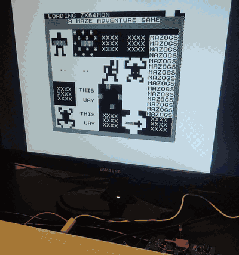
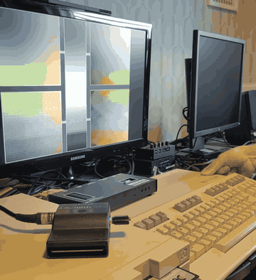

# zx64

**A ZX81 inside a Commodore 64. Well, inside its CP/M cartridge. And
inside a Commodore 128, on its own Z80.**

The real Sinclair ZX81 ROM, running on the Z80 of Commodore's CP/M
cartridge. Not an emulator: the ROM's own code runs, with eleven routines
patched to use the C64's VIC, keyboard and disk drive; the 6510 handles
the disk. Plus a Supermon-style Z80 machine code monitor on F5.

The C128 has a Z80 of its own, so it needs no cartridge: zx128vic puts
the ZX81 on its 40-column screen, and zx128 puts the ZX81, a panel and
the monitor side by side on the 80-column screen.

<p align="center">
  
  <br><sub>On the real thing: the monitor loads, then F5 in and out of Mazogs. The LED shows which CPU has the machine.
  <a href="docs/img/demo.mp4">Full clip</a>.</sub>
</p>

<p align="center">
  
  <br><sub>zx128 on a C128: switched on, the ZX81 is there in seconds, from the function ROM. Mazogs loads from the 1571 (sped up here), then F5 in and out.
  <a href="docs/img/demo128.mp4">Full clip</a>.</sub>
</p>

## Quick start

Needs the CP/M cartridge on a [compatible C64](docs/manual.md#the-hardware),
with [one extra wire](docs/cpm-cart.md#the-int-wire), or a C128, or VICE
(`x64sc -cpmcart`, `x128`); your own ZX81 ROM; GNU z80asm, acme, c1541
(VICE) and Python 3.

```sh
cp ~/somewhere/zx81.rom rom/
cp ~/somewhere/*.p games/       # optional
make                            # build/zx64.d64, zx128.d64, zx128vic.d64
```

On the C64: `LOAD "ZX81",8`, `RUN`. Then `LOAD "MAZOGS"`, as from tape.

On a C128: `build/zx128.d64` (80 columns) or `build/zx128vic.d64` (40)
in drive 8, and switch on. Or put `build/zx128.rom` in the function ROM
socket, and the ZX81 is there at power-on.

## What you get

- The ZX81 in SLOW mode at about twice a real one's speed, 16K, 32K or
  1K, the picture through the VIC's raster interrupt.
- A fast loader where the drive supports it (JiffyDOS, as on an
  SD2IEC): about 7 times the kernal's speed.
- `LOAD` and `SAVE` from disk, with a progress bar.
- Type-ahead and the ZX81's layout on the C64 keyboard
  ([overlay](docs/img/keyboard.png), [to print](docs/keyboard.pdf));
  six colour schemes.
- A joystick in port 2 as ZX81 keys: 5678+0, or a game's own keys,
  taught on the spot.
- zx64mon, a machine code monitor: memory, disassembler, assembler,
  breakpoints, single step, disk and DOS commands, in any running
  program.
- `tools/pcheck.py`: warns about games that won't work, as they go on
  the disk.
- `make test`: both CPUs in emulators, with the real hardware's quirks
  modelled; hundreds of checks over the three builds.

On the C128, the same, and:

- No cartridge and no wire: the C128's own Z80.
- zx128: the ZX81 on the 80-column screen, the panel beside it, and the
  monitor beside the running picture, which changes as you step.
- zx128vic: the ZX81 on the 40-column screen.
- Starts by itself: from the disk's boot sector, or from a function ROM
  or cartridge with no disk at all.
- Burst loading from a 1571; the monitor always in memory; the keypad
  and the cursor keys ([overlay](docs/img/keyboard128.png),
  [to print](docs/keyboard128.pdf)).

Not possible: hi-res, WRX and other display tricks.

## Documentation

- [The manual](docs/manual.md): background, how it works, using it, the
  monitor with examples, the test programs, zx128vic and zx128 and how
  they use the C128, troubleshooting.
- [The cartridge](docs/cpm-cart.md): what zx64 relies on, with sources;
  the `/INT` wire and the LED mod.
- [Testing](docs/testing.md): what `make test` covers, and what has been
  checked on hardware.

## Extras

Tools that work on their own:

- [memtest128](extras/memtest128/): a memory test for the C128's VDC RAM
  and an REU.
- [jtest](extras/jtest/): does a drive speak JiffyDOS, and how fast.
- [ultimate.py](extras/ultimate/): the Ultimate-II+'s REST API from the
  command line.
- [zx0.py](extras/zx0/): the ZX0 packer and unpacker in Python.
- [zxbasic.py](extras/zxbasic/): ZX81 BASIC as text to a `.p` file.

## Credits

- **Sinclair Research** for the ZX81 ROM (now Amstrad's/Sky's). It isn't
  included; the files zx64 builds contain yours.
- **The CP/M cartridge's documenters:** Ruud Baltissen's
  [description and schematic](http://www.baltissen.org/newhtm/c64_cpm.htm),
  the [zimmers.net archive](https://www.zimmers.net/anonftp/pub/cbm/schematics/cartridges/c64/cpm/),
  Dirk Wouters (DL2DW)'s [replica](https://codeberg.org/diwou/Commodore_CPM_Cartridge),
  VICE's `cpmcart.c` and MAME's `bus/c64/cpm.cpp` (read, not used).
- **The games shown** (not included): Mazogs (Don
  Priestley, Bug-Byte, 1982), 3D Monster Maze (Malcolm Evans, J.K.
  Greye, 1982), Fungaloids (Michael Orwin, 1982), 1K ZX Chess (David
  Horne, 1982).
- **Tools:** GNU z80asm, ACME, VICE, z80dasm, and the
  [z80](https://pypi.org/project/z80/) and [py65](https://pypi.org/project/py65/)
  emulators.
- **Einar Saukas** for [ZX0](https://github.com/einar-saukas/ZX0), the
  format zx128's function ROM is packed in (`extras/zx0/` is zx64's own
  Python version, written from its README).

## AI disclosure

Written with Anthropic's Claude, mostly in Claude Code. The idea, the
hardware and the decisions are the author's; the design, code, tools and
docs are drafted with Claude. The author tests on the real machines; on
the C128, Claude also runs tests through the Ultimate-II+'s API
(`extras/ultimate/`).
Corrections from people who know the cartridge are welcome: open an
issue.

## License

MIT, see [LICENSE](LICENSE). The ZX81 ROM isn't covered.
