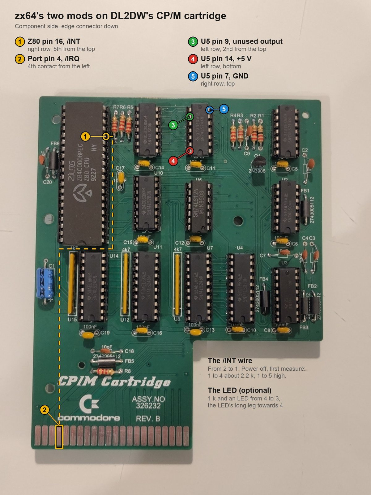
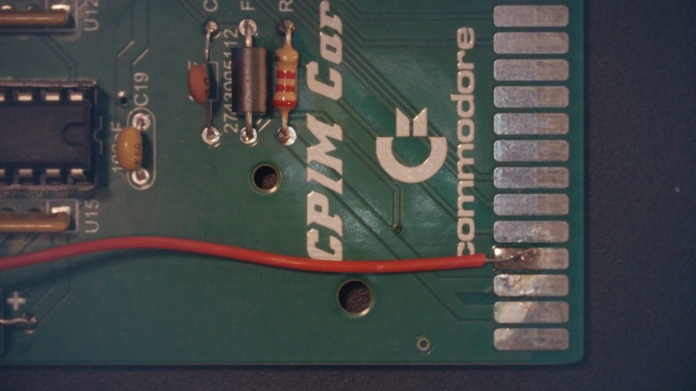
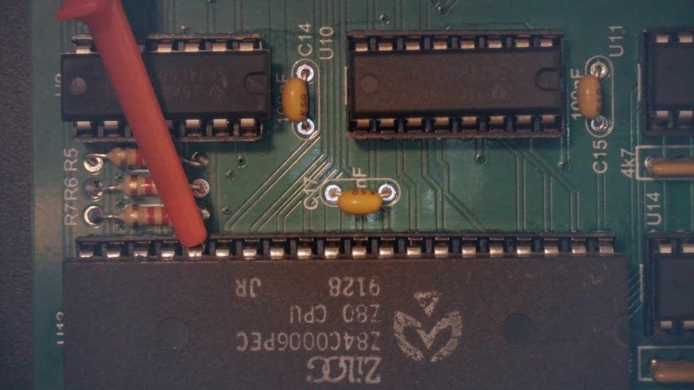
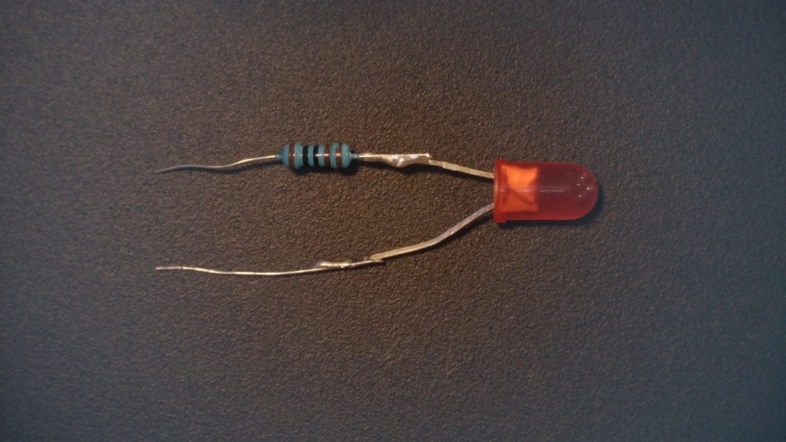
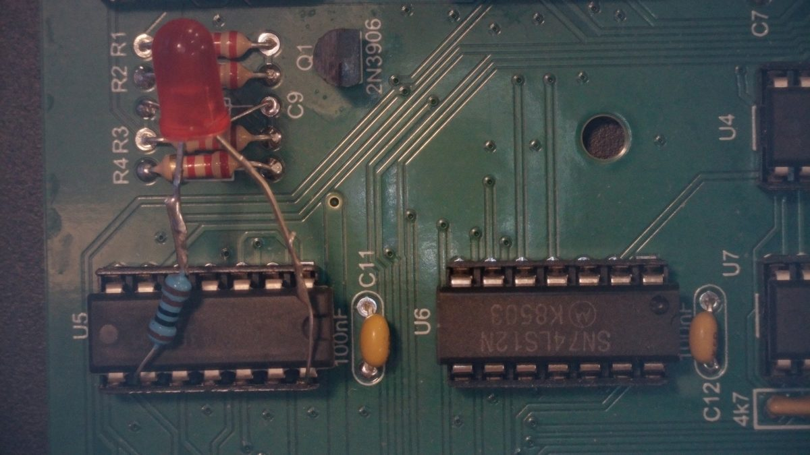

# The C64 CP/M cartridge: what zx64 relies on

Each fact is marked by where it comes from: **source** (documentation,
schematics, or how VICE/MAME model it), **VICE**, **make test**, or
**hardware** (C64 Reloaded MK2 with DL2DW's replica, Rev. B).

Sources:

- Ruud Baltissen, [C64 CP/M cartridge](http://www.baltissen.org/newhtm/c64_cpm.htm):
  the original board, reverse-engineered, with schematic
- [zimmers.net](https://www.zimmers.net/anonftp/pub/cbm/schematics/cartridges/c64/cpm/):
  CP/M cartridge schematics
- VICE [`src/c64/cart/cpmcart.c`](https://github.com/VICE-Team/svn-mirror/blob/main/vice/src/c64/cart/cpmcart.c)
- MAME [`src/devices/bus/c64/cpm.cpp`](https://github.com/mamedev/mame/blob/master/src/devices/bus/c64/cpm.cpp)
- Dirk Wouters (DL2DW), [Commodore_CPM_Cartridge](https://codeberg.org/diwou/Commodore_CPM_Cartridge):
  a 1:1 replica (schematic V1.0, Altium project, Gerbers)
- Commodore 64 CP/M Operating System User's Guide (1983)

## Memory

- **Z80 address + `$1000` = C64 address**, wrapping at 64K (Baltissen,
  VICE, MAME). The ZX81 ROM at Z80 `$0000` is at C64 `$1000`; the C64's
  I/O is at Z80 `$C000-$CFFF`. **source, VICE**
- The Z80's accesses go through the C64's map as `$01` sets it. zx64 runs
  the Z80 with `$35` (I/O, otherwise RAM) and the 6510's disk I/O with
  `$36` (kernal, no BASIC, so a 32K save reads the RAM at `$A000`).
  **hardware**

## Switching CPUs

- **A write to `$DE00-$DEFF` switches**: bit 0 = 0 starts the Z80, 1
  stops it (Z80 `$CE00`). The 6510 is held by `/DMA`, the Z80 by `BUSRQ`;
  each carries on after its own write. **source, VICE, hardware**
- **A NOP must follow each switching write**, on both CPUs (Commodore's
  guide, 6.6.1 and 6.7.1). Without it the Z80 lost the byte after its
  switch: `LD A,$F1` ran as `POP AF` and `LOAD "BOULDERL"` crashed. VICE
  doesn't model this. **hardware**
- The Z80 starts at `$0000` on its first switch after reset, which needs
  a NOP too (the guide, 6.6). **VICE**
- Any write to that page switches, including a stray `POKE 52736,1`.
  The 6510 side clears the mailbox command as it takes it, so a stray
  switch hands straight back. **make test**
- On the replica, the switch is U5B (74LS74). Its /Q (pin 8) drives
  `/DMA` through U6C (open-collector 74LS12), and `BUSRQ` and `WAIT`; its
  Q (pin 9) is unconnected. `BUSAK` is no use as a "Z80 running" signal:
  the VIC's `BA` also drives `BUSRQ`, so it toggles at every bad line.
  **source**

## I/O

- **`IN`/`OUT` are memory accesses.** The cartridge decodes neither
  `MREQ` nor `IORQ` (Baltissen); VICE and MAME map I/O onto memory.
  `OUT (n),A` writes memory at `A*256+n`. **source**
- **A single read of the VIC, a CIA or colour RAM can be wrong.** Seen:
  `$D019`'s raster flag set on the line after each bad line; a keyboard
  column reading `$D0` with no key down; colour RAM copied with LDIR
  coming out in runs of wrong colours about one bad line apart. Cause
  unknown; VICE doesn't do it. zx64 reads the keyboard three times and
  votes, wants F-keys down ~2 ms before acting, trusts the raster flag
  only outside the bad-line rows (line 250 to the top border), and never
  reads I/O where a write will do. **hardware**
- `$D011` bit 7 reads as the raster line's bit 8, so `$D011` can't be
  saved and restored by reading it. **hardware**

## Interrupts

- **The original cartridge doesn't connect the Z80's `INT` or `NMI`**
  (Baltissen: "both are NOT used!"; MAME agrees). **source**
- **VICE delivers the C64's IRQ to the Z80** (IM 1), never an NMI. **VICE**
- **The replica pulls `/INT` up** (R6, 2k2; R7 for `NMI`) and leaves port
  pin 4 (`/IRQ`) unconnected: the screen doesn't change while a program
  runs. **source, hardware**
- Without `/INT`, zx64 polls the raster flag in the ROM's key wait, so
  the picture changes only there. **make test, hardware**. Once an IRQ
  has arrived it waits for IRQs instead, until it sees the flag still set
  on two reads in a row (no IRQ took it), and polls again. **make test**
- Without the cartridge, the write to `$DE00` does nothing; zx64's
  loader sees the Z80 never started (`$4000` unchanged) and returns to
  BASIC with a message. **VICE, hardware**

### The `/INT` wire

Connect expansion port pin 4 (`/IRQ`) to Z80 pin 16 (`/INT`). On the
replica, R6 and the C64's 3k3 pull-up share the line (~1.3k), which the
VIC and CIAs still pull low; R6 can stay. **hardware** (test hooks):
Mazogs animates and plays through.

<p align="center"></p>

On the replica (component side, edge connector down) the Z80's notch is
at the bottom: pin 1 is bottom right, pin 16 the 5th from the top of the
right row, next to R7/R6/R5. Port pin 4 is the 4th contact from the
left.

Measure first, power off, from Z80 pin 16 to +5 V and to GND (U5's
pins 14 and 7, marked 4 and 5, are the handiest):

- a few kΩ to +5 V, high to GND: a pull-up; add the wire
- ~0 Ω to +5 V: tied to the supply. Don't add the wire (it would short
  `/IRQ` to +5 V); lift the pin or cut the trace first
- anything else: find out why first

The Z80 resets with interrupts off, so CP/M won't notice the wire unless
a program enables them.

As built: the wire soldered to port pin 4 (left; the edge connector is
turned to the right, pin 1 at the bottom), its other end on Z80 pin 16
with a test hook, which is enough (right).

<p align="center">
  
  
</p>

### LED while the Z80 runs

```
+5 V (U5 pin 14) ──▶|── 1 kΩ ── U5 pin 9 (Q, unconnected)
                  LED
```

U5 is the middle chip of the top row in the marked photo (its label is
hidden; the position is from the replica's PCB file), pins marked 3-5.
Notch down: pins 1-7 up the right row, 8-14 down the left. Check with a meter
(ground on pin 7): pin 9 high at `READY.`, below 0.4 V with zx64
running. On another board, use the flip-flop output that is low while
`/DMA` is.

Only one way round works: the LED's long leg (its anode) towards pin 14,
+5 V. Reversed, it stays dark (no harm done). Which side of the LED the
resistor sits on doesn't matter.

U5 pin 9 is low while the Z80 has the bus and sinks 2-3 mA (a 74LS74
output takes 8 mA). The LED is lit while zx64 runs and off while the
6510 does disk I/O or sits at `READY.`; bad lines don't affect it.
**hardware**: leads pushed into U5's socket beside the chip, no
soldering.

<p align="center">
  
  
</p>

In the right photo U5 lies on its side: pins 8-14 run along the lower
row from left to right, so the resistor's lead is at pin 9 (2nd from the
left) and the LED's leg at pin 14 (the right end).

## Clock

- Baltissen: the dot clock (~8 MHz) halved and gated by the 6510's half
  of the cycle, "about 3 MHz". MAME uses 3 MHz; VICE 2 T-states per C64
  cycle (~2 MHz), held on bad lines. **source**
- Measured with `SPEED`: about 1.8 T-states per C64 cycle. **hardware**
