# zx64 manual

## Contents

- [Background](#background)
- [How it works](#how-it-works)
- [Getting started](#getting-started)
- [Using the ZX81](#using-the-zx81)
- [Games](#games)
- [The monitor](#the-monitor)
- [The test programs](#the-test-programs)
- [Troubleshooting](#troubleshooting)

## Background

Commodore's CP/M cartridge (1983) is remembered as a flop. It put a Z80
next to the C64's 6510 so the C64 could run CP/M, and C64 CP/M is often
called the worst CP/M port there was: slow, short of memory, little
software, and disks no other CP/M machine of the day could read. The
cartridge is rare now, and notoriously picky about the C64 it's plugged
into. The author built a few replicas of Dirk Wouters's (DL2DW) design
and tried them on about seven C64s from his collection, breadbins and
C64Cs alike. CP/M either wouldn't start at all or crashed after a few
minutes.

On a C64 Reloaded MK2, the same cards turn out to be rock solid. That is
the machine zx64 was developed and tested on: see
[The hardware](#the-hardware).

The cartridge's trick is a single register: a write to `$DE00` stops
the 6510 and hands the whole machine, memory and I/O chips, to the Z80.
But then there is nothing. No kernal, no screen editor, no keyboard
routine: a Z80 in front of 64K of RAM and a VIC, with no idea what to do
with them. Unless you bring your own operating system.

The ZX81's is 8K: BASIC, the editor, the display, the keyboard and tape,
written for a Z80 and almost nothing else. Most of what the ZX81's ULA
did in hardware, a C64 can do with its VIC, its CIA and some help from
the 6510. zx64 runs that ROM, with eleven routines patched, and the C64
becomes a ZX81.

## How it works

### Two CPUs, taking turns

The cartridge's Z80 and the C64's 6510 share the same memory and the
same chips, and take turns: only one of them runs at a time. A write to
`$DE00` hands the machine to the other, and the one that wrote it
freezes where it is until it gets the machine back.

<p align="center">
  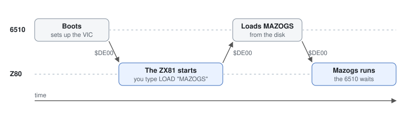
</p>

The 6510 starts things: the boot file (`LOAD "ZX81",8`, `RUN`, about
13K) holds its loader, your patched ROM and zx64. It sets up the VIC,
makes a character set from the ZX81 ROM's, and hands over. The Z80
starts at `$0000`, like a ZX81 switched on. From then on the Z80 runs
nearly all the time, and the 6510 only wakes up for the disk.

The Z80 sees the C64's memory shifted by 4K: where a ZX81 expects its
ROM, at `$0000`, it finds the C64's `$1000`. The shift is the
cartridge's own: an adder chip adds `$1000` to every Z80 address, so
CP/M got RAM at `$0000` while the 6510 kept its zero page, stack and
screen. It wraps around, so the Z80 still reaches all 64K: its top 4K
is the C64's bottom 4K. Addresses in this manual are the Z80's, as the
monitor shows them.

<p align="center">
  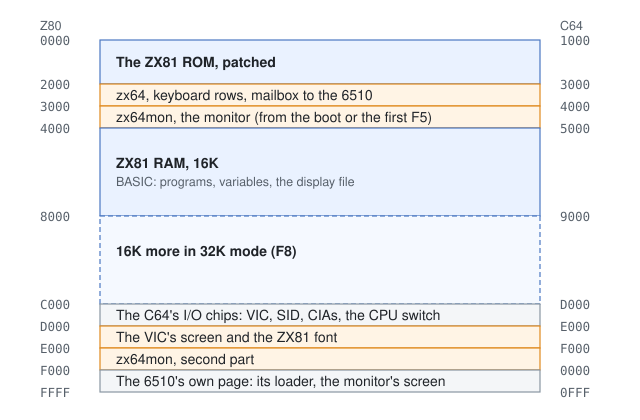
</p>

### The picture

A ZX81 has no video chip. With a little help from the ULA, its Z80 draws
the picture itself, 50 times a second, from the screen's contents in RAM
(the display file). That is why a ZX81 is slow in SLOW mode: most of its
time goes into drawing. In FAST mode it stops drawing to compute, and
the screen goes blank.

The C64's VIC draws a picture on its own; it only needs to be told what
to show. So zx64 keeps the VIC's screen memory up to date instead: when
the VIC signals the end of a frame, zx64 copies the display file across,
every other frame. The ROM never notices: it writes to its display file
as always. The Z80 spends only the copy on the picture, which is why
zx64 is nearly twice as fast as a real ZX81 in SLOW mode. In FAST mode
zx64 stops copying, so the picture holds still instead of going blank.

<p align="center">
  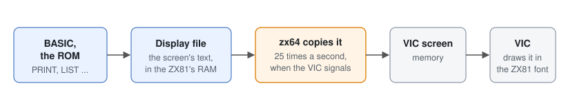
</p>

The VIC's signal reaches the Z80 through its interrupt line, which the
cartridge leaves unconnected: one wire fixes that, see
[the /INT wire](cpm-cart.md#the-int-wire).

### The keyboard

The ZX81's ROM reads its keyboard as 8 rows of 5 keys. The C64's is a
grid of 8 by 8 keys. 50 times a second zx64 reads the C64's grid, works
out which ZX81 key each pressed key stands for, and writes the result
where the ROM expects its keyboard rows. From there the ROM's own
keyboard code takes over, unchanged.

<p align="center">
  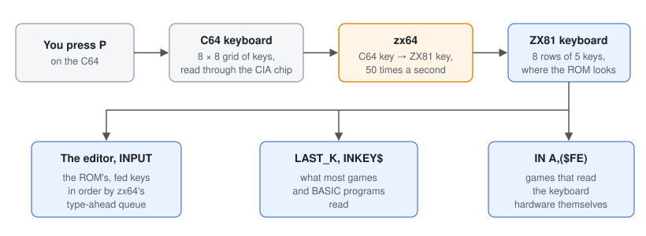
</p>

zx64 adds two things on the way. Type-ahead queues keys in the order
you press them, so fast typing isn't lost. And it filters out ghost
keys: some combinations of keys held down make the C64's keyboard report
one that isn't pressed. Typed quickly, `TEST` could come out as `TESFT`;
zx64 gives `TEST`.

### The disk

The disk is the 6510's job. For `LOAD` and `SAVE` the Z80 leaves a
command and the name in a mailbox at `$2F00` and writes `$DE00`. The
6510's loader, waiting since `RUN`, does the work through the C64's
kernal, fills the bar on the top row, and switches back. The monitor's
disk commands go the same way.

### What zx64 changes in the ROM

Only what touched the ZX81's hardware. Eleven places, each checked byte
for byte by `tools/build.py` first, so another ROM is refused rather
than broken. The rest of the ROM runs as Sinclair wrote it.

- **The picture:** the ZX81's interrupt (`$0038`) becomes zx64's, which
  copies the screen; the display routine (`$0277`) waits for it.
- **SLOW and FAST** (`$0207`, `$02E7`, `$04CC`): interrupts on or off
  instead of the display on or off.
- **The keyboard** (`$02BB`) and **BREAK** (`$0F46`): read from the C64's
  keys.
- **LOAD and SAVE** (`$0340`, `$02F6`): the disk instead of the tape.
- **The printer** (`$087B`): skipped. The **reset** (`$0000`): an `OUT`
  that only made sense on the ZX81 is gone.

The monitor's `D` shows them in place: see [Reading the ROM](#reading-the-rom).

### IN and OUT

On a ZX81, `IN` and `OUT` talk to hardware. On the cartridge they don't:
they read and write memory instead, at an address made from the port
number and the A register. zx64 makes good use of that: it puts the
keyboard rows exactly where a game's `IN A,($FE)` will read them, so
games that read the keyboard themselves still work.

The catch is the other way: a game that writes to an add-on the ZX81 may
have had (a sound chip, a printer, a ZXpand) writes into memory instead,
possibly into the ROM. `tools/pcheck.py` warns about such games when they
go on the disk, and F7 repairs the ROM afterwards.

## Getting started

### The hardware

The CP/M cartridge is fickle: on most original C64 boards it may not
run at all. zx64 was developed on this setup:

- [C64 Reloaded MK2](https://wiki.icomp.de/wiki/C64_reloaded_mk2)
  (Individual Computers). Its USB serial link reads the C64's memory,
  which helped find several of the bugs.
- DL2DW's [CP/M cartridge replica](https://codeberg.org/diwou/Commodore_CPM_Cartridge):
  schematic, Gerbers and parts list, plus one wire for `/INT` (and,
  optionally, an [LED](cpm-cart.md#led-while-the-z80-runs) that shows
  which CPU has the machine).
- An [SD2IEC](https://www.tfw8b.com/sd2iec-info/).

Other setups may work; reports are welcome.

<p align="center">
  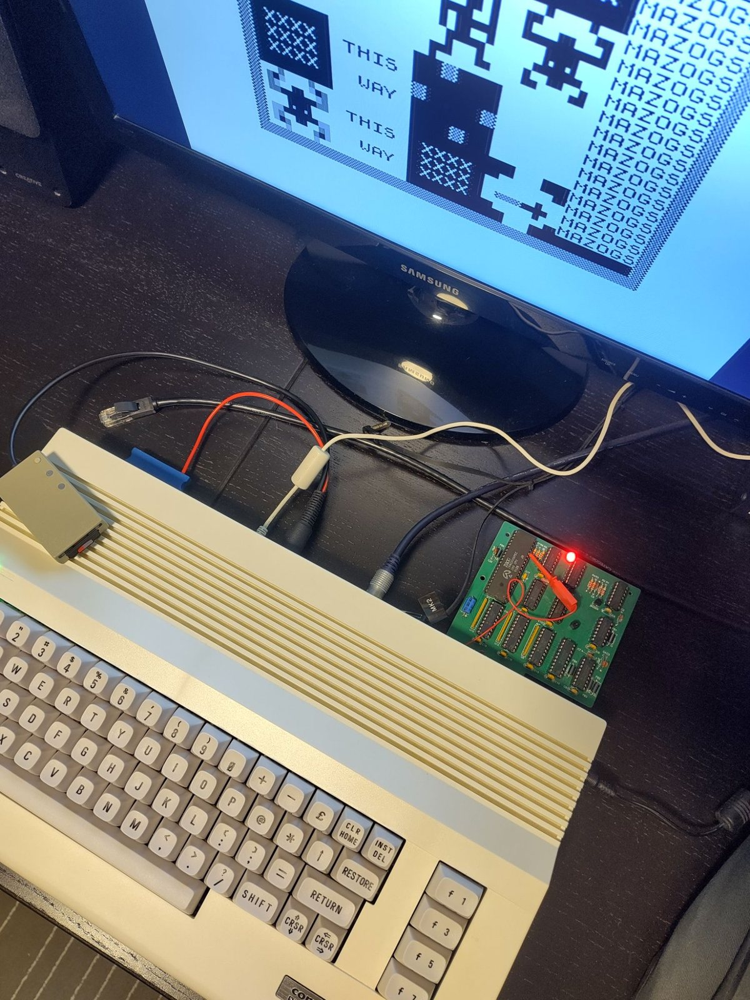
  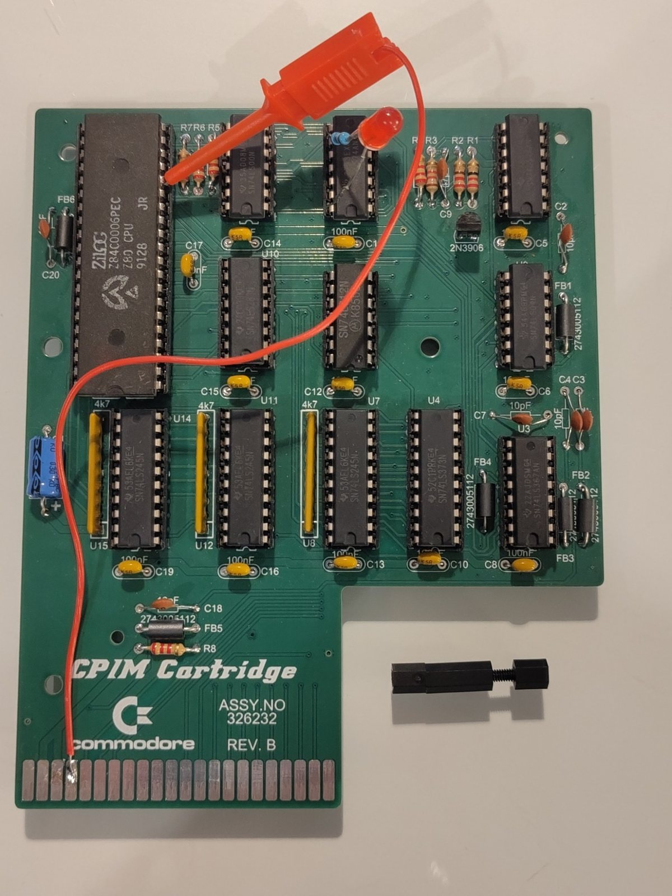
</p>

The setup, running Mazogs with the LED lit; and the card as used: the
`/INT` wire soldered at the edge connector and clipped to the Z80, the
LED in U5's socket, and a standoff to keep the card steady in the port.

### Building and booting

You need:

- A C64, the CP/M cartridge with the [/INT wire](cpm-cart.md#the-int-wire),
  and a disk drive.
- Or, without the hardware, VICE: its `x64sc` emulates the cartridge
  (`-cpmcart`), interrupt included, so no wire is needed.
- Your own ZX81 ROM as `rom/zx81.rom` (8192 bytes, the standard
  second version).
- GNU z80asm, acme, c1541 (from VICE) and Python 3 to build.

```sh
cp ~/somewhere/zx81.rom rom/
cp ~/somewhere/*.p games/       # any games for the disk
make
```

Put `build/zx64.d64` on a disk for your drive, then on the C64:

    LOAD "ZX81",8
    RUN

Loading takes about 27 seconds at the kernal's speed.

In VICE: `make vice`, and set the keyboard mapping to positional.

## Using the ZX81

The keys are on the same places as on the ZX81's keyboard, with the
ZX81's legends:

<p align="center">
  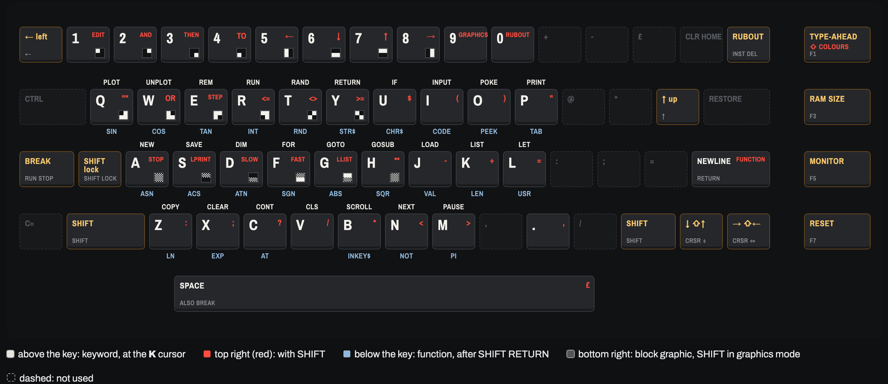
</p>

Printable overlay: [keyboard.pdf](keyboard.pdf). Keyboard viewer, to
open locally: `docs/keyboard.html`.

| Key | |
|---|---|
| SPACE, RUN/STOP | BREAK |
| F1 | type-ahead on or off |
| F2 (SHIFT F1) | the next colour scheme |
| F3 | memory: 16K, 32K, 1K (resets) |
| F5 | the monitor |
| F7 | reset |

- **Type-ahead** (on by default): type at C64 speed.
- **Colour schemes**: black on white, white on black, green screen,
  amber, black on green, C64 blue.
- **Memory** (F3): 16K, the default, as with Sinclair's RAM pack; 32K,
  RAM from `$4000` to `$BFFF`, all for BASIC; 1K, the bare ZX81.
- **F7**: reset, keeping the settings. A ROM changed by a program is
  read again from disk first.

## Games

Yes, games. `LOAD "MAZOGS"` and off you go, as from tape, but with a
bar that fills while it loads:

<p align="center">
  
</p>

<p align="center">
  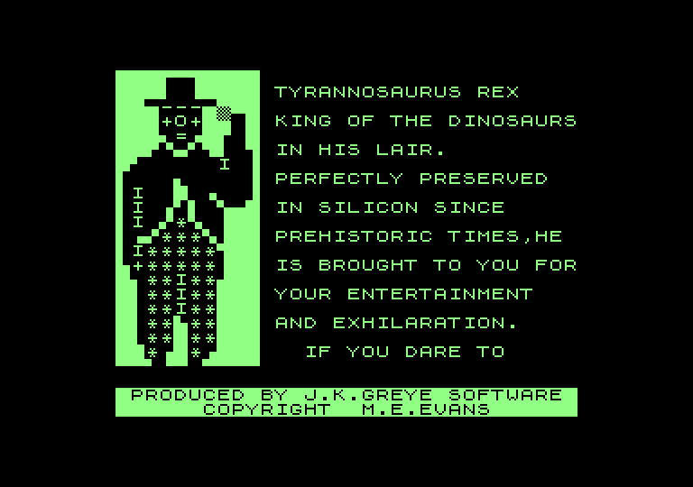
  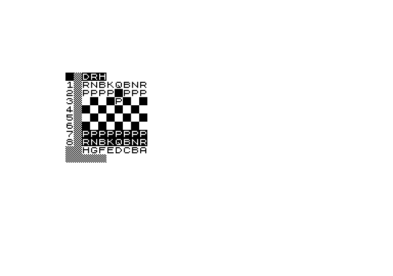
  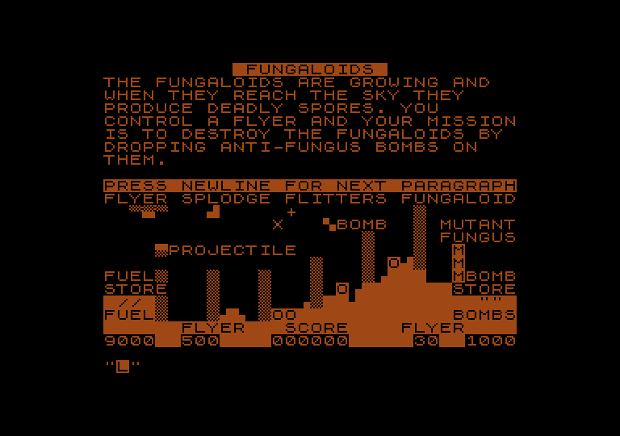
</p>

Played on the C64: Mazogs, BoulderL, 3D Monster Maze, Fungaloids, 1K ZX
Chess, Tetris, Tetris 1K and Mine81. Out of reach: hi-res and WRX
graphics, and anything else that changes how the ZX81 draws its
picture.

Any `.p` file loads from any disk in the drive zx64 booted from: copy
its bytes into a PRG file (for example
`c1541 games.d64 -write mazogs.p mazogs`). Or put it in `games/` before
`make`: it goes on zx64's disk, and `tools/pcheck.py` warns if it uses
something zx64 can't do, such as add-on hardware or hi-res. `SAVE
"NAME"` saves to the same disk.

## The monitor

This is zx64's party trick. Press F5 and the ZX81 stops wherever it is,
in BASIC, the editor or the middle of a game, and zx64mon opens: a
machine code monitor in the style of Jim Butterfield's Supermon, but for
the Z80. Memory, a disassembler, an assembler, breakpoints, single
stepping and the disk, on a 40-column screen with the C64's full
keyboard. `X` (or F5) and the program carries on as if nothing happened.
[See it on the real machine](img/demo.mp4).

ZX81 owners in 1981 had a membrane keyboard, a tape recorder and `POKE`.
Here the C64 becomes a Z80 development machine: write a routine, run it
from BASIC, stop it, step through it, fix it, save it. And since the
ZX81 is about as simple as a Z80 computer gets, it's a fine place to
learn.

<p align="center">
  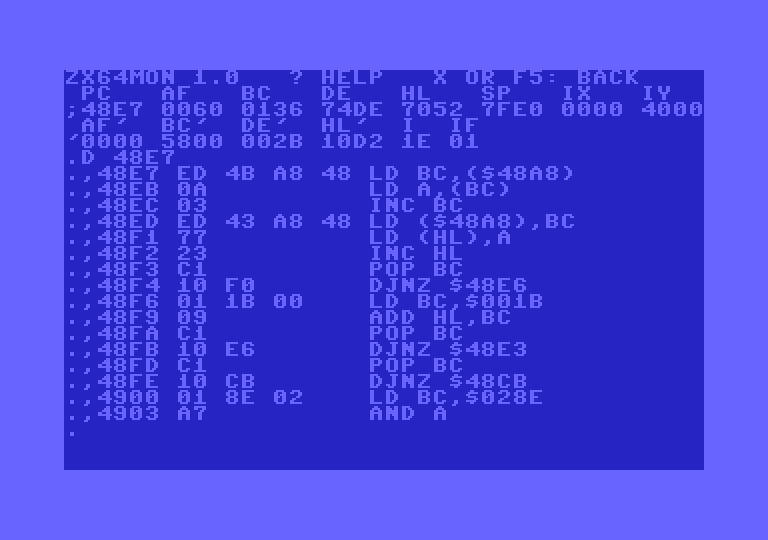
</p>

The screen works as a C64's: move the cursor anywhere, change what is
there, press RETURN to enter that line. A memory line from `M` or a
disassembly line from `D` can be edited in place and entered again.
Numbers are hex. RUN/STOP stops a long listing.

    M s [e]          memory, 8 bytes a line, with their ZX81 characters
    D s [e]          disassemble; M or D alone goes on
    A a text         assemble at a
    : a b b ...      store bytes (what M's lines are)
    R                the registers, as ; and ' lines to edit
    G [a]            carry on (at a); X does the same
    B [a]            breakpoint on or off (four at most); B alone lists
    S                one step; RETURN steps again
    F s e b          fill
    T s e d          transfer (overlap is fine)
    C s e d          compare
    H s e b b ...    hunt bytes; H s e 'TEXT hunts ZX81 characters
    $                the disk's directory
    L "NAME" [a]     load a file to its own address, or to a
    W "NAME" s e     write s-e as a PRG with its C64 address
    @[cmd]           the drive's status, or a DOS command
    ?                help

The monitor is loaded from the disk on the first F5 (about 7K). It works
wherever zx64 reads the keyboard: always in SLOW mode, and in FAST mode
at the prompt and between BASIC statements. There's no NMI, so FAST
machine code that never reads the keyboard can't be stopped.

Nothing is protected: the ROM, zx64 and the C64's I/O are all memory, and
the monitor changes whatever you tell it to. Only the disk commands
refuse the 6510's page and the I/O chips.

### Machine code in a REM line

The classic ZX81 way: a `REM` line at the start of the program holds the
machine code. Its first byte after the `REM` is at 16514 (`$4082`), and
`USR 16514` runs it, returning BC as the result.

This one adds 1 to 100 and leaves the sum in BC and in memory. First the
room for it, 24 bytes of `REM`, and two lines to run it:

    1 REM 012345678901234567890123
    10 PRINT USR 16514
    20 PRINT PEEK 16534+256*PEEK 16535

Then F5, and `A` at `$4082`. After each line the monitor offers the next
address; RETURN on an empty one ends:

    A 4082 LD HL,$0000
    LD B,$64
    LD E,B
    LD D,$00
    ADD HL,DE
    DJNZ $4087
    LD ($4096),HL
    LD B,H
    LD C,L
    RET

<p align="center">
  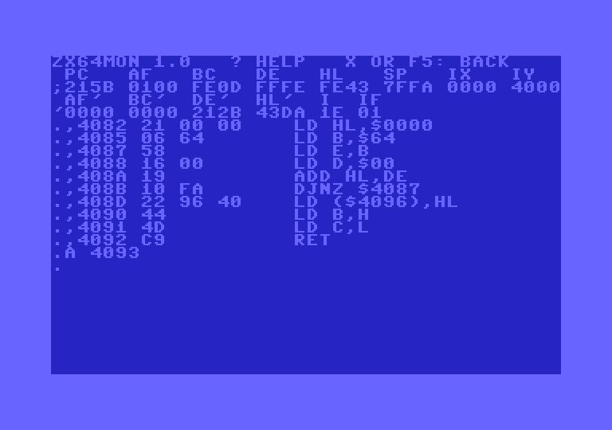
  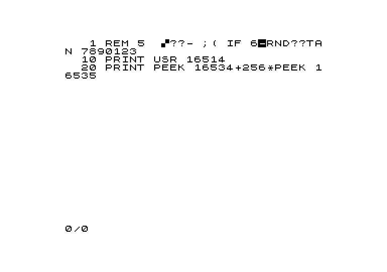
</p>

The assembler takes Zilog's mnemonics as `D` writes them, numbers as
`$12` or with a leading digit, `0DE` (a bare `DE` is the register). It
works by search: it tries encodings, disassembles each, and keeps the
one that reads as your text, so whatever `D` prints, `A` takes back.
That's up to about a second for the rarest instructions on the real
machine. A line from `D` changed on the screen and entered is assembled
too.

`X`, then `LIST`: the `REM` now holds the code, shown as ZX81 characters
and keywords. `RUN` prints 5050 twice: once from BC, once from the two
bytes at `$4096` (16534). `M 4082 4099` shows them as `BA 13`:

<p align="center">
  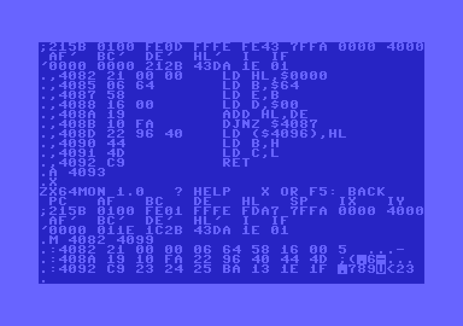
</p>

To watch it run, set a breakpoint and step:

    B 408D           a breakpoint after the loop
    X                back to BASIC; RUN
                     the monitor opens at 408D: HL = 13BA
    S                LD ($4096),HL, then the registers
                     RETURN steps again; INST/DEL the S and G goes on

A breakpoint is a `RST $38` in place of the instruction's first byte;
zx64's interrupt handler tells it from an interrupt. It works without
the `/INT` wire too. The monitor puts the real bytes back while it's
open, so `M` and `D` show the code as it is. Not possible: breakpoints in
zx64 or the monitor (`$2000-$3FFF`), at `$0038`, or from `$C000` up.

### Reading the ROM

The ROM is RAM here, readable and writable like the rest. `D` shows
zx64's patches in place:

<p align="center">
  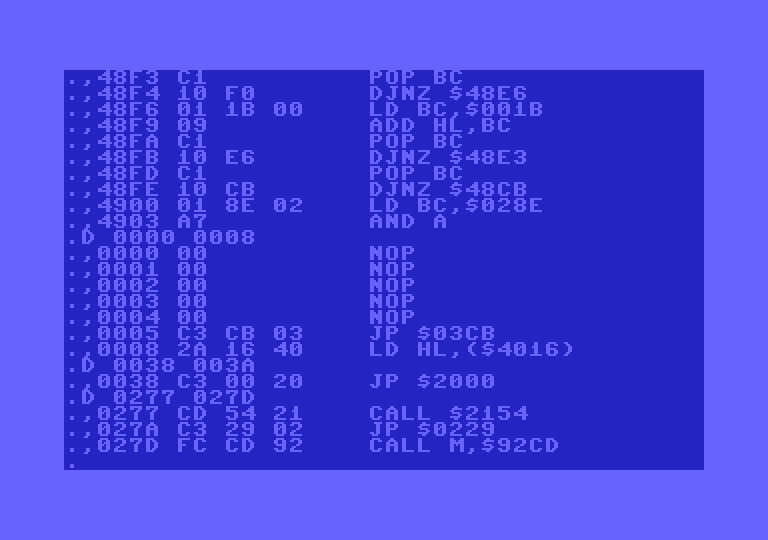
</p>

- `0038`, the ZX81's INT, is `JP $2000`: zx64's raster interrupt.
- `0277`, DISPLAY-1, calls zx64's frame wait and goes back to `$0229`.
- `0000` should be `NOP NOP` and `LD BC,$7FFF`, but shows five NOPs. The
  ROM's floating-point calculator uses the first five bytes of memory as
  scratch space; on a ZX81 those writes hit ROM and vanish, here they
  stick. Harmless, since only a reset runs that code, and zx64's reset
  skips it.

### Patching the ROM

The ROM's keyword table holds each keyword in ZX81 characters, the last
one inverted. `H` finds `PRIN` twice: in `LPRINT` at `$0171`, and `PRINT`
itself at `$01C3`. Overwrite it with `WRITE`:

    H 0000 1FFF 'PRIN
    :01C3 3C 37 2E 39 AA

<p align="center">
  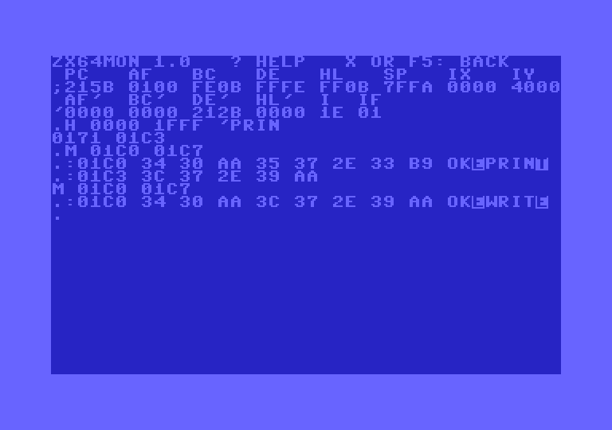
  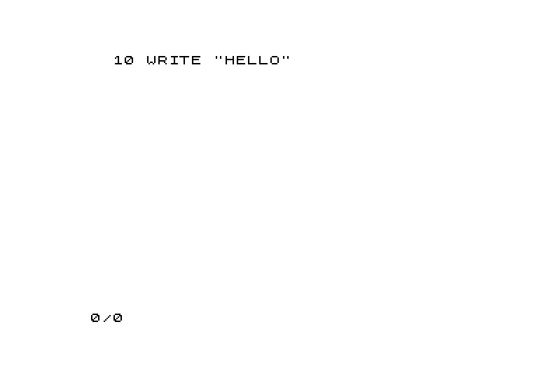
</p>

Back in BASIC, `LIST` shows `WRITE`, and the keyword works as before:
the ROM finds keywords by their position in the table, not their text.
F7 notices the changed ROM and reads it again from the disk, with the
bar on the top row: " LOADING ZX81 ROM".

### Disk commands

`$` lists the directory. `L "NAME"` loads a PRG to the address in its
first two bytes (a C64 address), or to the address given. `W "NAME" s e`
writes memory as a PRG with the C64's load address, so `LOAD
"NAME",8,1` on a plain C64 puts it back where it was.

    W "ROM" 0000 1FFF        the patched ROM, 33 blocks (C64 $1000)
    L "ROM" 8000             loaded to $8000 instead

`@` alone reads the drive's status; `@` with text sends a DOS command:

    @S:ROM                   scratch
    @R:MAZOGS.P=MAZOGS       rename

The text goes to the drive as it is, so an SD2IEC's own commands work
from here too, without leaving the ZX81:

    @CD:GAMES.D64            mount another disk image
    @CD:←                    and back (← is the C64's left arrow key)

## The test programs

The d64 always has four, made from `progs/*.bas` with zx64's addresses
filled in. Each runs as it loads.

- **`SPEED`** checks the setup and times 50 turns of an empty `FOR`
  loop. PAL or NTSC; `/INT SEEN` 1 means the wire works; stray IRQs
  are interrupts the VIC didn't raise (noise on the wire). zx64 takes 30
  frames, a UK ZX81 56-58 (see [The picture](#the-picture)). In FAST mode
  it's the other way round: the ZX81's 3.25 MHz Z80 is about twice as
  fast as the cartridge's, which gets about 1.8 T-states per C64 cycle.
- **`MEM`** tests every free byte: machine code in a `REM` writes a
  pattern from each byte's address into all of them, reads them back,
  then the same with the complement. 14,728 bytes in 16K, 31,112 in 32K.
- **`PAUSE`** does `PAUSE 500` between GO and STOP: 10 seconds on PAL,
  to time with a stopwatch. A check that the interrupt comes 50 times a
  second.
- **`FAST`** counts to 100 in FAST mode (the picture holds), prints how
  many frames went by meanwhile (0, as on a ZX81), then loops in FAST
  for you to stop with SPACE or RUN/STOP (report D/230).

## Troubleshooting

- **The picture freezes while a program runs; games ignore keys.** The
  `/INT` wire is missing or loose. `SPEED` says `/INT SEEN: 0`. Push the
  cartridge fully home; half-seated, the picture freezes and keys come
  and go.
- **"NO Z80: ZX64 NEEDS THE C64 CP/M CARTRIDGE."** The boot file found
  no Z80: no cartridge, or it isn't seated.
- **Report D on LOAD.** The file isn't on the drive the boot file came
  from, under that name or with `.P`. `@` in the monitor shows the
  drive's message.
- **A game crashes, or F7 hangs.** It may write where it shouldn't:
  `tools/pcheck.py -v` shows its `OUT`s and where they land. F7 repairs
  the ROM, but not zx64's own code; then reload the boot file.
- **"NO ZX64MON ON THE DISK"** on F5: the files `zx64mon` and `zx64mon2`
  aren't on the drive zx64 booted from.
- **Typing in VICE gives the wrong keys.** Set VICE's keyboard mapping
  to positional.

## The source

| Path | |
|---|---|
| `z80/zx64.asm` | the Z80 side: interrupts, picture, keyboard, disk via the mailbox |
| `z80/mon.asm` | zx64mon |
| `c64/boot.asm` | the 6510 side: boot, VIC setup, disk I/O |
| `tools/build.py` | patches the ROM, assembles, builds the d64 |
| `tools/pcheck.py` | checks `.p` files for what won't work |
| `tools/zxbasic.py` | BASIC text to `.p`, for `progs/` |
| `tools/simulate.py` | `make test`: both CPUs in emulators |
| `tools/shots.py` | this manual's screenshots, from the same emulators |
| `progs/` | the test programs |
| `scripts/` | headless VICE, for testing on Linux |

More: what zx64 relies on about the cartridge, with sources, in
[cpm-cart.md](cpm-cart.md); what has been tested, in
[testing.md](testing.md).
