# zx64 manual

## Contents

- [Background](#background)
- [How it works](#how-it-works)
- [Getting started](#getting-started)
- [Using the ZX81](#using-the-zx81)
- [The games](#the-games)
- [The monitor](#the-monitor)
- [The test programs](#the-test-programs)
- [zx128vic](#zx128vic)
- [zx128](#zx128)
- [Troubleshooting](#troubleshooting)
- [The source](#the-source)

## Background

Commodore's CP/M cartridge (1983) is remembered as a flop. It put a Z80
next to the C64's 6510 so the C64 could run CP/M, and C64 CP/M is often
called the worst CP/M port there was: slow, short of memory, little
software, and disks no other CP/M machine of the day could read. The
cartridge is rare now, and notoriously picky about the C64 it's plugged
into. On about seven C64s, breadbins and C64Cs alike, replicas of Dirk
Wouters's (DL2DW) design either don't start CP/M at all or crash after a
few minutes.

On a C64 Reloaded MK2, the same cards are rock solid. That is
the machine zx64 is tested on: see
[The hardware](#the-hardware).

The cartridge's trick is a single register: one write to it stops the
6510 and hands the whole machine, memory and I/O chips, to the Z80.
But then there is nothing. No kernal, no screen editor, no keyboard
routine: a Z80 in front of 64K of RAM and a VIC, with no idea what to do
with them. Unless you bring your own operating system.

The ZX81's is 8K: BASIC, the editor, the display, the keyboard and tape,
written for a Z80 and almost nothing else. Most of what the ZX81's ULA
did in hardware, a C64 can do with its VIC, its CIA and some help from
the 6510. zx64 runs that ROM, with eleven routines patched, and the C64
becomes a ZX81.

The flop had a lucky sequel. Commodore promised that the C128 would run
CP/M, with the very same cartridge. The story goes that the cartridge
wouldn't work with the C128, so its designers put a Z80 on the main board
instead. Every C128 has the cartridge's trick built in: a Z80 of its
own, to which the 8502 hands the machine with a write to a register.
That gives zx64 two C128 builds, with no cartridge and no wire:
[zx128vic](#zx128vic) puts the ZX81 on the C128's 40-column screen, and
[zx128](#zx128) puts the ZX81, a panel and the monitor side by side on
its 80-column screen.

## How it works

### Two CPUs, taking turns

The cartridge's Z80 and the C64's 6510 share the same memory and the
same chips, and take turns: only one of them runs at a time. A write to
`$DE00` hands the machine to the other, and the one that wrote it
freezes where it is until it gets the machine back.

<p align="center">
  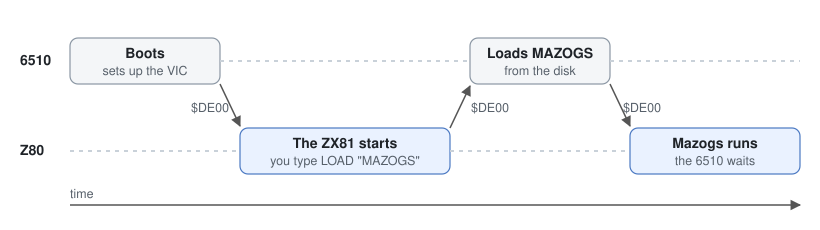
</p>

The 6510 starts things. The boot file, `ZX81`, loads `ZX64`, which holds
the 6510's loader, your patched ROM and zx64, and starts it. `ZX64` sets
up the VIC, makes a character set from the ZX81 ROM's, and hands over.
The Z80 starts at `$0000`, like a ZX81 switched on. From then on the Z80
runs nearly all the time, and the 6510 only wakes up for the disk.

The Z80 sees the C64's memory shifted by 4K: where a ZX81 expects its
ROM, at `$0000`, it finds the C64's `$1000`. The shift is the
cartridge's own: it adds `$1000` to every Z80 address, so CP/M got RAM
at `$0000` while the C64 kept its own bottom 4K. It wraps around, so the
Z80 still reaches all 64K: its top 4K is the C64's bottom 4K. Addresses
in this manual are the Z80's, as the monitor shows them.

<p align="center">
  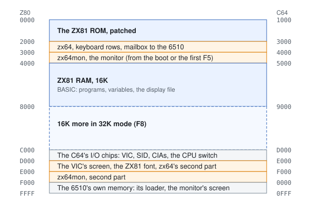
</p>

### The picture

A ZX81 has no video chip. With a little help from the ULA, its Z80 draws
the picture itself, 50 times a second, from the display file, the
screen's contents in RAM. That is why a ZX81 is slow in SLOW mode: most
of its time goes into drawing. In FAST mode it stops drawing to compute,
and the screen goes blank.

The C64's VIC draws a picture on its own; it only needs to be told what
to show. So zx64 keeps the VIC's screen memory up to date instead: it
copies the display file across every other frame, when the VIC signals
that it has drawn one. The ROM never notices: it writes to its display
file as always. The Z80 spends only the copy on the picture, which is
why zx64 is nearly twice as fast as a real ZX81 in SLOW mode. In FAST
mode zx64 stops copying, so the picture holds still instead of going
blank.

<p align="center">
  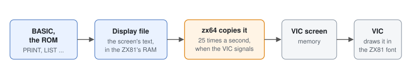
</p>

The VIC's signal reaches the Z80 through its interrupt line, which the
cartridge leaves unconnected: one wire fixes that, see
[the /INT wire](cpm-cart.md#the-int-wire).

### The keyboard

The ZX81's ROM reads its keyboard as 8 rows of 5 keys. The C64's is a
grid of 8 by 8 keys. 50 times a second zx64 reads the C64's grid, works
out which ZX81 key each pressed key stands for, and writes the result
where the ROM expects its keyboard rows. From there the ROM's own
keyboard code takes over, unchanged.

<p align="center">
  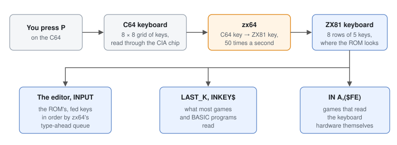
</p>

zx64 adds two things on the way. Type-ahead queues keys in the order
you press them, so fast typing isn't lost. And it filters out ghost
keys: some combinations of keys held down make the C64's keyboard report
one that isn't pressed. Typed quickly, `TEST` could come out as `TESFT`;
zx64 gives `TEST`.

A joystick in port 2 goes in at the same place, as the ZX81 keys of its
[layout](#the-joystick). Its lines are the keyboard's column lines, so
with the stick held a key in one of its columns shows in every column:
fire and `0` together would read as F7, the reset. zx64 takes those
ghosts out too; while the stick is held, a second key in the same row
as such a key can't be read.

### The disk

The disk is the 6510's job. For `LOAD` and `SAVE` the Z80 leaves a
command and the name in a mailbox and writes `$DE00`. The
6510's loader, waiting since `RUN`, does the work, fills the bar on the
top row, and switches back. The monitor's disk commands go the same way.
It reads by JiffyDOS when the drive answers to it, with its own code for
the serial bus: about seven times as fast as the kernal. Otherwise, and
for writing, it uses the C64's kernal.

### What zx64 changes in the ROM

Only what touched the ZX81's hardware: a handful of places, each
checked by `tools/build.py` first, so another ROM is refused rather than
broken. The rest of the ROM runs as Sinclair wrote it.

- **The picture:** the ZX81's interrupt becomes zx64's, which copies the
  screen; the display routine waits for it.
- **SLOW and FAST:** interrupts on or off instead of the display on or
  off.
- **The keyboard** and **BREAK:** read from the C64's keys.
- **LOAD and SAVE:** the disk instead of the tape.
- **The printer:** skipped. The **reset:** an `OUT` that only made sense
  on the ZX81 is gone.

The monitor's `D` shows them in place: see [Reading the ROM](#reading-the-rom).

### IN and OUT

On a ZX81, `IN` and `OUT` talk to hardware. On the cartridge they don't:
they read and write memory instead, at an address made from the port
number and the A register. zx64 makes good use of that: it puts the
keyboard rows exactly where a game's `IN A,($FE)` will read them, so
games that read the keyboard themselves still work.

The catch is the other way: a game that writes to a sound chip, a
printer, a ZXpand or another add-on the ZX81 may have had writes into
memory instead, possibly into the ROM. `tools/pcheck.py` warns about
such games when they go on the disk, and F7 repairs the ROM afterwards.

## Getting started

### The hardware

zx64 is tested on this setup:

- [C64 Reloaded MK2](https://wiki.icomp.de/wiki/C64_reloaded_mk2)
  (Individual Computers). Its USB serial link reads the C64's memory.
- DL2DW's [CP/M cartridge replica](https://codeberg.org/diwou/Commodore_CPM_Cartridge):
  schematic, Gerbers and parts list, plus one wire for `/INT`, and if you
  like an [LED](cpm-cart.md#led-while-the-z80-runs) that shows which CPU
  has the machine.
- An [SD2IEC](https://www.tfw8b.com/sd2iec-info/).

Other setups may work; reports are welcome.

<p align="center">
  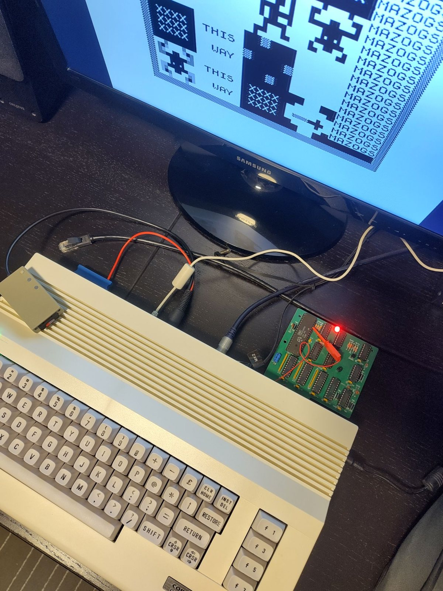
  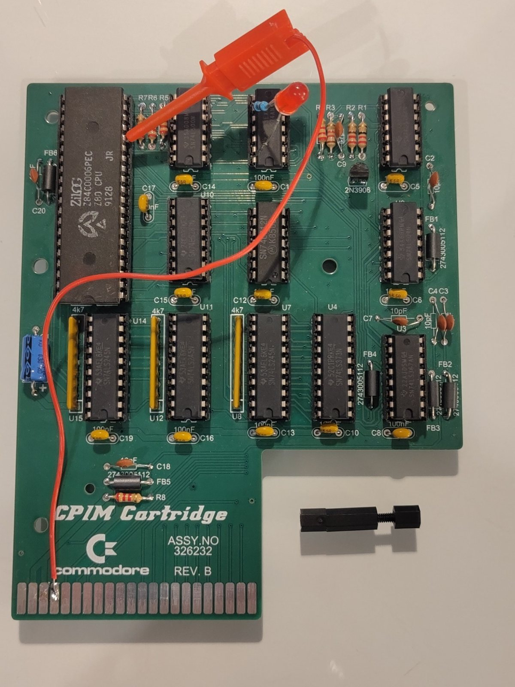
</p>

The setup, running Mazogs with the LED lit; and the card as used: the
`/INT` wire soldered at the edge connector and clipped to the Z80, the
LED in U5's socket, and a standoff to keep the card steady in the port.

### Building and booting

You need:

- A C64, the CP/M cartridge with the [/INT wire](cpm-cart.md#the-int-wire),
  and a disk drive.
- Or, without the hardware, VICE: its `x64sc` emulates the cartridge
  (`-cpmcart`), interrupt included, so no wire is needed.
- Your own ZX81 ROM as `rom/zx81.rom` (8192 bytes, the standard
  second version).
- GNU z80asm, acme, c1541 from VICE, and Python 3 to build.

The tools on macOS, Ubuntu and Debian; Debian has VICE in its contrib
section, which has to be enabled first:

```sh
brew install z80asm acme vice           # macOS
sudo apt install z80asm acme vice       # Ubuntu, Debian
```

On Fedora, z80asm is a package and VICE is in RPM Fusion's nonfree
repository; acme is built from source, in a few seconds:

```sh
sudo dnf install z80asm vice
git clone https://salsa.debian.org/debian/acme.git
make -C acme/src
cp acme/src/acme ~/bin/
```

`make test` also needs the z80 and py65 Python packages, and a C++
compiler to build z80: `build-essential python3-dev python3-venv` on
Ubuntu and Debian, `gcc-c++ python3-devel` on Fedora.

```sh
python3 -m venv .venv && .venv/bin/pip install z80 py65
```

Then the ROM, any games, and `make`:

```sh
cp ~/somewhere/zx81.rom rom/
cp ~/somewhere/*.p games/       # any games for the disk
make
```

Put `build/zx64.d64` on a disk for your drive, then on the C64:

    LOAD "ZX81",8
    RUN

`LOAD` takes a second or two; `RUN` loads the rest. On a drive with
JiffyDOS, like an SD2IEC, the ZX81 is ready about 10 seconds after
`RUN`, with the monitor already loaded, so F5 opens it at once. Other
drives load the kernal's way, in about half a minute, and F5 loads the
monitor the first time.

In VICE: `make vice`, and set the keyboard mapping to positional.

## Using the ZX81

The keys are in the same places as on the ZX81's keyboard, with the
ZX81's legends:

<p align="center">
  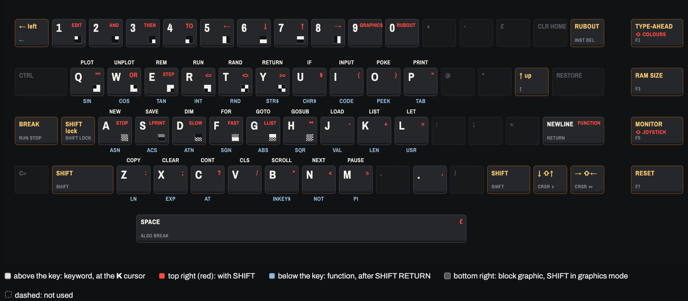
</p>

Printable overlay: [keyboard.pdf](keyboard.pdf). Keyboard viewer, to
open locally: `docs/keyboard.html`.

| Key | |
|---|---|
| SPACE, RUN/STOP | BREAK |
| F1 | type-ahead on or off |
| F2 (SHIFT+F1) | the next colour scheme |
| F3 | the joystick: 5678+0 or your own keys; held, set your own |
| F5, F6 (SHIFT+F5) | the monitor |
| F7 | reset |
| F8 (SHIFT+F7) | memory: 16K, 32K, 1K (resets) |

- **Type-ahead**, on at the start: type at C64 speed.
- **Colour schemes**: black on white, white on black, green screen,
  amber, black on green, C64 blue. Only the ZX81's 32 by 24 characters
  show the background colour; the rest of the screen is in the border's.
- **Memory**: 16K, the default, as with Sinclair's RAM pack; 32K,
  RAM from `$4000` to `$BFFF`, all for BASIC; 1K, the bare ZX81.
- **Reset**: the settings stay. If a program wrote over the ROM, it is
  read again from the disk first.

## The games

Yes, games. `LOAD "MAZOGS"`, watch the bar fill, and off you go:

<p align="center">
  
</p>

<p align="center">
  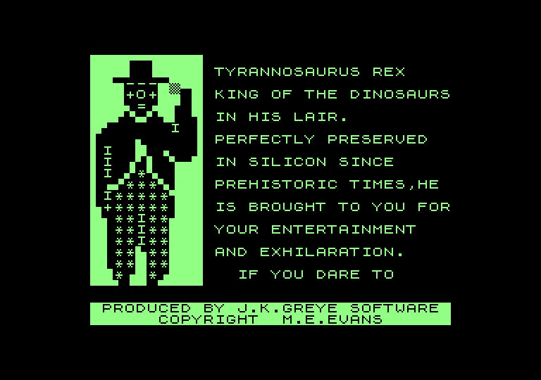
  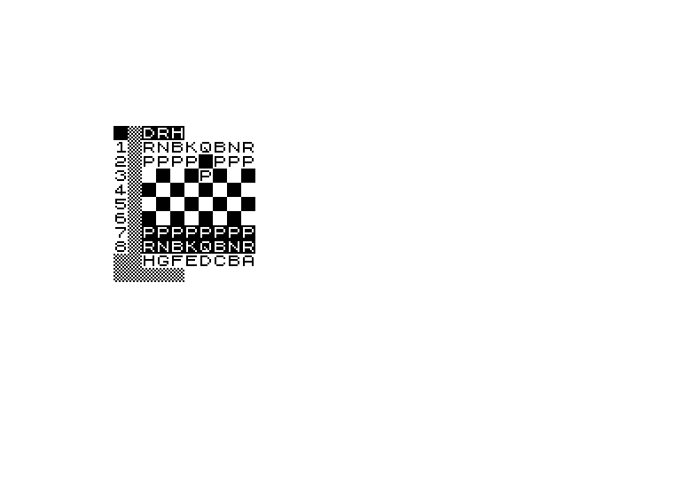
  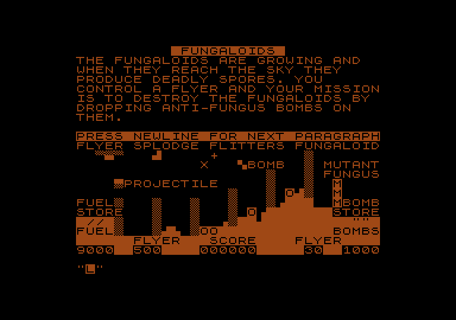
</p>

Most games just work. Nearly all draw with the ZX81's own characters
and block graphics, and those run, from Mazogs and 3D Monster Maze to 1K
ZX Chess. What doesn't:

- **Hi-res and WRX graphics**, and anything else that changes how the
  ZX81 draws its picture: the screen shows nothing useful. A game with
  its own character set plays, but in the ZX81's letters. Newer games,
  written long after the ZX81's day, use such tricks more often than the
  old ones, so expect more of them not to work.
- **Add-on hardware**: a printer, a sound board, the ZXpand, or RAM
  between 8K and 16K, where zx64 keeps its own code.
- **Keys in FAST mode**: a game that reads the keyboard itself while in
  FAST mode may not see your keys, or see keys you didn't press.

A game in several parts loads the next one by its name: put all of them
on the disk. A program that keeps its data in the variables it was saved
with starts with `GOTO 1` rather than `RUN`, as on a ZX81: `RUN` clears
the variables.

Put your `.p` files in `games/` and run `make`: they go on zx64's disk,
and `tools/pcheck.py` tells you if one uses something zx64 can't do.
Then `LOAD "NAME"`. `SAVE "NAME"` saves to the same disk.

### The joystick

A joystick in port 2 maps to ZX81 keys: at the start the ZX81's cursor
keys, 7 6 5 8 for up, down, left and right, and 0 for fire. A game that
uses other keys can be taught them; F3 then switches between the two
layouts, each shown on the top row as its keys: `U7 D6 L5 R8 F0`.

**Your own keys:** hold F3 for a second. The program stops where it is
and the top row asks for each key in turn, a `?` at the one it wants:
`U? D- L- R- F-`. Press the game's key for it. F1 gives a direction no
key, F5 gives up and keeps the layout as it was. After the fire key the
program carries on with your layout, which stays until you switch off.

On a diagonal, BASIC games see the direction pressed last;
games that read the keyboard themselves see both. In FAST mode, holding
F3 doesn't teach keys: F3 only switches.

## The monitor

This is zx64's party trick. Press F5 and the ZX81 stops wherever it is,
in BASIC, the editor or the middle of a game, and zx64mon opens: a
machine code monitor in the style of Jim Butterfield's Supermon, but for
the Z80. Memory, a disassembler, an assembler, breakpoints, single
stepping and the disk, on a 40-column screen with the C64's full
keyboard. `X` or F5, and the program carries on as if nothing happened.
[See it on the real machine](img/demo.mp4).

The first F5 shows the monitor's title and the registers, and so does
one that has to load the monitor from the disk again. After that, F5
brings the monitor back as you left it, the cursor on the line under
your last one; `R` shows the registers again, `?` the title and the help.

ZX81 owners in 1981 had a membrane keyboard, a tape recorder and `POKE`.
Here the C64 becomes a Z80 development machine: write a routine, run it
from BASIC, stop it, step through it, fix it, save it. And since the
ZX81 is about as simple as a Z80 computer gets, it's a fine place to
learn.

<p align="center">
  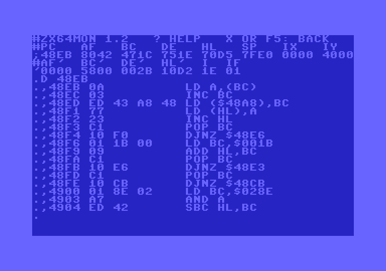
</p>

The screen editor works as the C64's. The monitor's headings and
messages start with `#`, an error is `#?`, and RETURN on such a line
does nothing, so moving about the screen is safe. HOME goes to the top
row, CTRL+HOME to the bottom one. A memory line from `M` or a
disassembly line from `D` can be edited in place and entered again; on
an `M` line, the hex or the characters, `PRINT` to `PRONT` say. The
characters are stored as they show: a reversed one as the inverse
character, a plain one not. RVS ON and OFF work as on the C64; RETURN
turns it off too. A character the ZX81 hasn't got, such as `!`, is `?`.
After RETURN the line is drawn again from memory, so it shows what was
stored. RUN/STOP stops a long listing.

CRSR UP on the top row and CRSR DOWN on the bottom one scroll an `M` or
`D` listing: the line before or after it comes in, and `M` or `D` alone
goes on after the last. Under a short listing, CRSR DOWN on the bottom
row fills the rows down to it, and the cursor stays there. Going back in
a `D` listing, the monitor finds the instruction before by disassembling
from a few bytes earlier; data mixed with the code can make that come
out differently.

Numbers and addresses are hex; `s` and `e` are where a range starts and
ends.

| Command | What it does | Example |
|---|---|---|
| `M s [e]` | Shows memory, 8 bytes a line, with their ZX81 characters. `M` alone goes on. | `M 4000` |
| `D s [e]` | Disassembles. `D` alone goes on. | `D 0038` |
| `A a text` | Assembles one instruction at `a`, and offers the next address. | `A 4082 RET` |
| `B [a]` | Sets a breakpoint at `a`, or takes it off again; four at most. `B` alone lists them. | `B 4089` |
| `S` | Steps one instruction. RETURN steps again. | `S` |
| `G [a]` | Carries on, or from `a`. `X` does the same. | `G` |
| `R` | Shows the registers, on lines you can change. | `R` |
| `V` | Shows the ZX81's system variables. On the C128 only. | `V` |
| `: a b ...` | Stores bytes, and ZX81 text between `'`s. | `:4082 3E 01` |
| `F s e b` | Fills a range with a byte. | `F 7000 70FF 00` |
| `T s e d` | Copies a range to `d`; overlapping is fine. | `T 4000 40FF 7000` |
| `C s e d` | Compares a range with the one at `d`. | `C 4000 40FF 7000` |
| `H s e b ...` | Hunts for bytes, or for ZX81 text after a `'`. | `H 0 1FFF 'PRIN` |
| `= n` | Shows a number in hex, decimal and binary. `+n` is decimal, `%n` binary. | `= +16514` |
| `Z n` | Makes line 1 a `REM` of `n` bytes, for machine code. | `Z 17` |
| `$` | Lists the disk's directory. | `$` |
| `L "NAME" [a]` | Loads a program, as `LOAD`; with `a`, any file to `a`. | `L "HELLO"` |
| `W "NAME" [s e]` | Saves the program, as `SAVE`; with `s e`, that range as a file. | `W "ROM" 0 1FFF` |
| `@[cmd]` | Shows the drive's status, or sends it a command. | `@S:ROM` |
| `?` | Shows the help, with examples. | `?` |

F5 works wherever zx64 reads the keyboard: always in SLOW mode, and in
FAST mode at the prompt and between BASIC statements. Nothing can
interrupt FAST machine code from outside, so if it never reads the
keyboard, it can't be stopped.

Nothing is protected: the ROM, zx64 and the C64's I/O are all memory, and
the monitor changes whatever you tell it to. `:C020 02` makes the
border red, from the Z80; leaving the monitor puts the colours back.
Only the disk commands hold back: `L` won't load over the I/O chips
(`C000`) or the 6510's own memory (`F000`), where its loader runs, and
`W` won't save the I/O chips.

### Machine code in a REM line

The classic ZX81 way: a `REM` line at the start of the program holds the
machine code. Its first byte after the `REM` is at 16514 (`$4082`), and
`USR 16514` runs it.

Hello world. First the room for it, 23 bytes (`$17`): F5, and

    Z 17

`Z` makes line 1 a `REM` of that many bytes, NOPs and a `RET` last. With
no program, it adds the line that runs it too, `10 RAND USR 16514`.

Then `A` at `$4082`. After each line the monitor offers the next
address; RETURN on an empty one ends, and `A 4082` alone offers the first.
Then the text, after the code, with `WORLD` typed in RVS ON:

    A 4082 LD HL,$408D
    LD A,(HL)
    INC A
    RET Z
    DEC A
    RST $10
    INC HL
    JR $4085

    :408D 'HELLO WORLD' FF

<p align="center">
  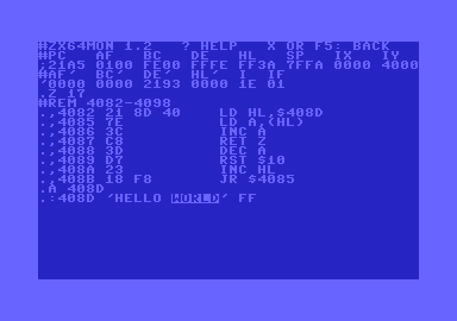
  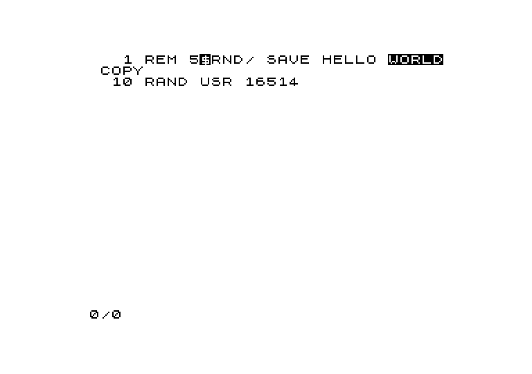
</p>

`RST $10` is the ZX81's CHROUT: it prints the character in A, keywords
and NEWLINE too, and keeps BC, DE and HL: it works in the other register
set, with `EXX`. The text ends with `FF`, as [Text in
memory](#text-in-memory) explains: `INC A` makes it 0, and `RET Z` goes
back to BASIC. `USR` returns BC as its value; `RAND USR` throws it away,
`PRINT USR` would print it after the text. Leave IX alone, and IY, which
the ROM needs to hold `$4000`.

The assembler takes Zilog's mnemonics as `D` writes them, numbers as
`$12` or with a leading digit, `0DE`; a bare `DE` is the register. It
works by search: it tries encodings, disassembles each, and keeps the
one that reads as your text, so whatever `D` prints, `A` takes back.
That's up to about a second for the rarest instructions on the real
machine. A line from `D` changed on the screen and entered is assembled
too. If the new instruction is shorter or longer than the old one, the
`D` line under it is no longer the next instruction, so the next address
is offered instead, as `A` does.

`X`, then `LIST`: the `REM` now holds the code, shown as ZX81 characters
and keywords, then `HELLO`, an inverse `WORLD`, and the `FF` as `COPY`,
the keyword with that code. Some of the code is missing: `$7E` marks a
number in a BASIC line, and `LIST` skips the 5 bytes after it. `RUN`
prints the same, `WORLD` inverse. `M 4082 4099` shows all the bytes, and
the text:

<p align="center">
  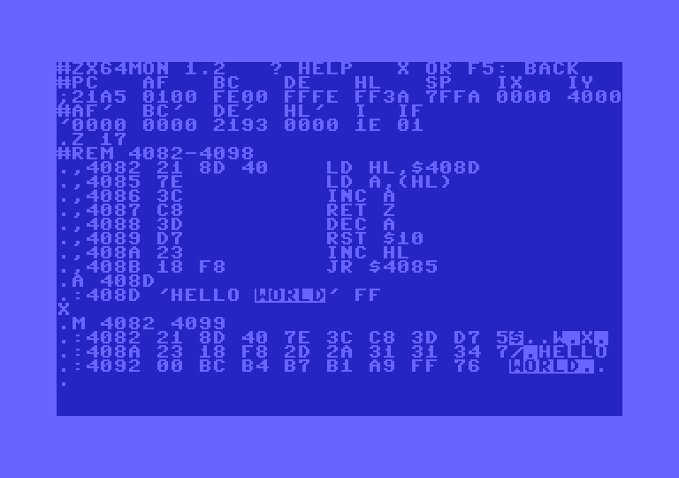
</p>

Not sure how much room the code will need? Start with some, and `Z`
again when it runs out: on a line 1 that is a `REM` already, `Z n` makes
it n bytes, keeping what is in it, with NOPs added at the end or bytes
cut from it. On a program without a line 1, `Z` puts the `REM` in front
of it, and adds no `RAND USR` line. A line 1 that isn't a `REM`, or no
room for it, is `?`. The program moves, so leaving after `Z` goes to
BASIC as after `L`: report 0, not back to what was running.

The code has to be assembled where it runs, at `$4082` on: `A` uses the
address it writes to for jumps and calls, so code tried out at `$7000`
doesn't work from the `REM` unless it only uses relative jumps, `JR` and
`DJNZ`.

To watch it run, set a breakpoint on the `RST $10`:

    B 4089           a breakpoint on the RST $10
    X                back to BASIC; RUN
                     the monitor opens at 4089: A = 2D, an H
    G                on: it stops there again, A = 2A, an E
    B 4089           the breakpoint off; G, and the rest is printed

<p align="center">
  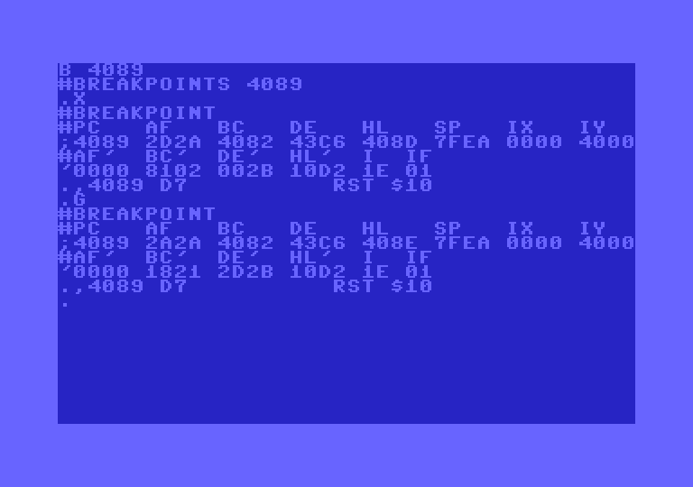
</p>

`S` steps one instruction instead; on the `RST $10` it goes into the
ROM, at `$0010`. RETURN steps again; to go on, delete the `S` and type
`G`. A breakpoint is a `RST $38` in place of the instruction's first
byte; zx64's interrupt handler tells it from an interrupt. It works
without the `/INT` wire too. The monitor puts the
real bytes back while it's open, so `M` and `D` show the code as it is.
Not possible: breakpoints in zx64 or the monitor (`$2000-$3FFF`), at
`$0038`, or from `$C000` up.

The ROM has a string printer too, the one `PRINT "..."` uses: BC
characters from DE, at `$0B6B`. With it, hello world is three
instructions and needs no end mark:

    A 4082 LD DE,$408B
    LD BC,$000B
    JP $0B6B

    :408B 'HELLO WORLD

`$000B` is the length, 11. The `JP` lets the ROM's routine return to
BASIC itself.

Or straight into the Z80's registers, without BASIC at all. F5, then

    A 7000 ADD HL,DE
    R

On the first register line, the one starting with `;`, note the PC:
it's where F5 stopped the ZX81. Type `7000` over it, `4321` over DE and
`1234` over HL, and RETURN. `S` runs that one instruction: HL is `5555`.

<p align="center">
  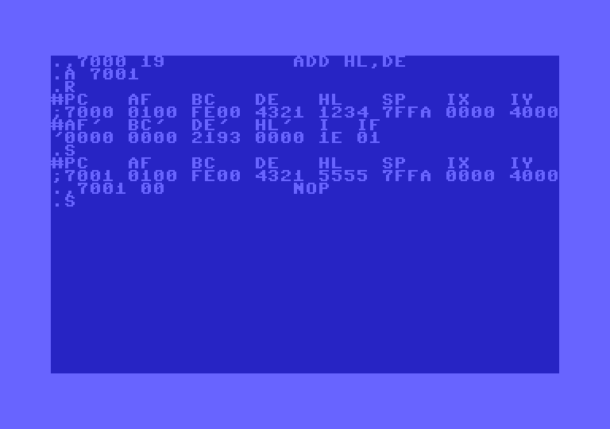
</p>

Then delete the `S` offered, put the old PC back on the `;` line, and
`X`: the ZX81 goes on as it was.

### Reading the ROM

The ROM is RAM here, readable and writable like the rest. `D` shows
zx64's patches in place:

<p align="center">
  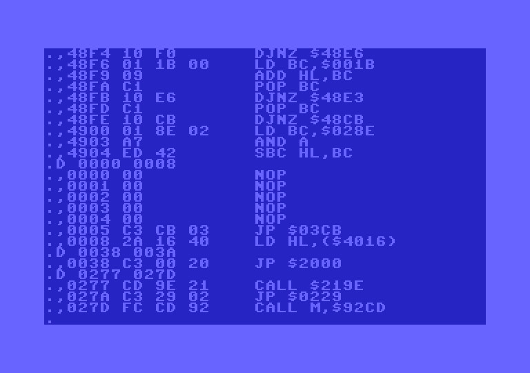
</p>

- `0038`, the ZX81's INT, is `JP $2000`: zx64's interrupt, once a frame.
- `0277`, in the ROM's display routine, calls zx64's frame wait and goes
  back to `$0229`.
- `0000` should be `NOP NOP` and `LD BC,$7FFF`, but shows five NOPs. The
  ROM's floating-point calculator uses the first five bytes of memory as
  scratch space; on a ZX81 those writes hit ROM and vanish, here they
  stick. Harmless, since only a reset runs that code, and zx64's reset
  skips it.

### Patching the ROM

The ROM's keyword table holds each keyword in ZX81 characters, the last
one inverted. `H` finds `PRIN` twice: in `LPRINT` at `$0171`, and `PRINT`
itself at `$01C3`. Overwrite it with `WRITE`:

    H 0000 1FFF 'PRIN
    :01C3 3C 37 2E 39 AA

<p align="center">
  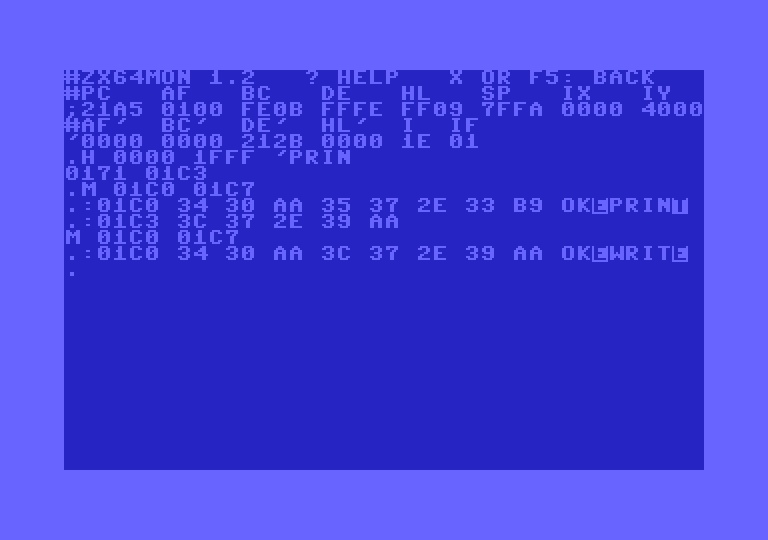
  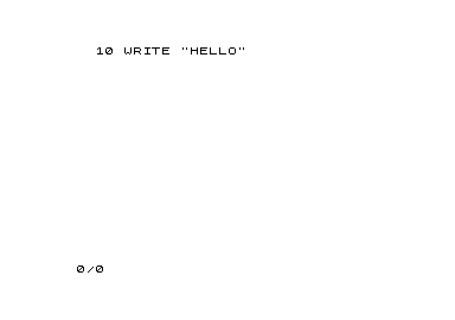
</p>

Back in BASIC, `LIST` shows `WRITE`, and the keyword works as before:
the ROM finds keywords by their position in the table, not their text.
F7 notices the changed ROM and reads it again from the disk, with the
bar on the top row: " LOADING ZX81 ROM".

The same as text: `:01C3 'WRIT' AA`, where `AA` is an inverse `E`. Or
`M 01C3` and type over `PRINT` on its line.

### Text in memory

`:` takes text between `'`s, as ZX81 characters, mixed with bytes;
characters typed with RVS ON are stored inverse. A
text that runs to the end of the line needs no closing `'`, and the
monitor offers the next line to go on with:

    :7000 'THE QUICK BROWN FOX JUMPS
    :7019 ' OVER THE LAZY DOG' FF

<p align="center">
  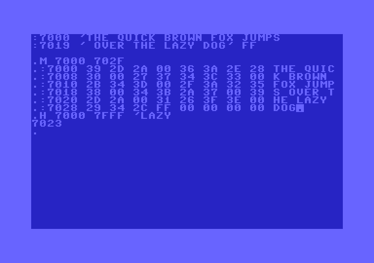
</p>

The second line's `:7019 '` is the monitor's; type the rest after it.
Spaces at a line's end are left out, so the space between the words
starts the second line; or close the first with `'`. RETURN on the
offered line with nothing added ends.

The `FF` ends the string. Not `00`: that's the ZX81's space. The ROM's
own ways are an inverse last character, as in the keyword table, and
`$76`, NEWLINE, which ends BASIC lines and the display file's rows.
`$FF` isn't a character at all, and `INC A` then `RET Z` or `JR Z`
finds it. `H 7000 7FFF 'LAZY` finds the text again.

### Disk commands

`$` lists the directory. Without addresses, `L` and `W` are BASIC's
`LOAD` and `SAVE`: the program, from `$4009` up to `E_LINE`, with the
code in its `REM` lines. So a program can be loaded to work on in the
monitor:

    L "HELLO"                #LOADED and where; D 4082 shows its code
    W "HELLO"                saved again, changes and all

After `L`, leaving the monitor with `X`, `G` or F5 goes on as `LOAD` does:
what was running is gone, a program saved from a program line runs, and
any other stops at the K cursor with report 0. `L` refuses a file that
isn't a program, `#? NOT A PROGRAM`, or one that doesn't fit, `#? TOO
BIG`, before anything is written; `LOAD` gives reports D and 4 for them.

With addresses they are for memory. `W "NAME" s e` writes s-e as a PRG
with the C64's load address, so `LOAD "NAME",8,1` on a plain C64 puts it
back where it was; `L "NAME" a` loads a PRG to a:

    W "ROM" 0000 1FFF        the patched ROM, 33 blocks (C64 $1000)
    L "ROM" 0000             back where it was
    L "ROM" 8000             or to $8000

`@` alone reads the drive's status; `@` with text sends a DOS command:

    @S:ROM                   scratch
    @R:MAZOGS.P=MAZOGS       rename

<p align="center">
  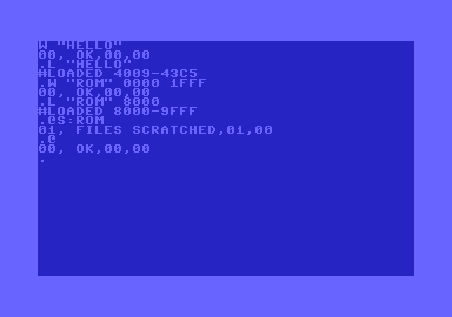
</p>

The text goes to the drive as it is, so an SD2IEC's own commands work
from here too, without leaving the ZX81:

    @CD:GAMES.D64            mount another disk image
    @CD:←                    and back

## The test programs

The disk has four, each running as it loads:

- **`SPEED`** checks the setup and times an empty loop: about twice as
  fast as a real ZX81. `/INT SEEN: 1` means the wire works; stray IRQs
  mean noise on it.
- **`MEM`** tests every free byte of memory.
- **`PAUSE`** waits 10 seconds between GO and STOP (on PAL), to time
  with a stopwatch.
- **`FAST`** shows that the picture holds in FAST mode, then loops for
  you to stop with SPACE or RUN/STOP.

<p align="center">
  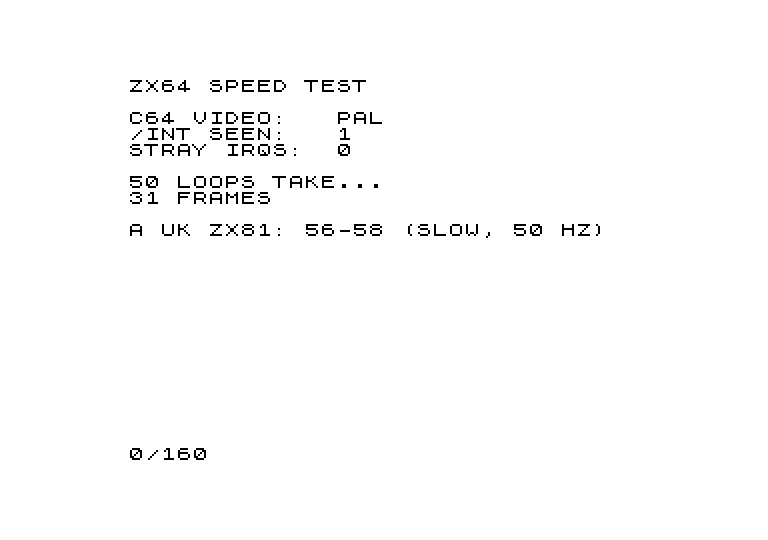
</p>

## zx128vic

The ZX81 on a Commodore 128's 40-column screen. The C128 has a Z80 of
its own, so all it takes is the disk: put it in, switch on, and the C128
boots into a ZX81 that runs faster than the real one. It's the same ZX81
as zx64's on the C64, with the same keys, colour schemes, joystick and
monitor, and the C128 adds to it:

- **Its own Z80,** on the C128's board, which the VIC's interrupt
  reaches too.
- **It starts by itself.** The disk has a C128 boot sector, so there is
  nothing to type. Or put it in a ROM, in the C128's function ROM socket
  or as a cartridge: switch on, and the ZX81 is there, no disk at all.
- **The monitor is always there.** 128K leaves room for it next to the
  ZX81, so F5 never loads anything.
- **F7 needs no disk.** A copy of the ROM stays in the C128's other
  64K, and F7 puts it back from there.
- **Burst loading** from a 1571: games load about five times as fast.
- **The keypad and the cursor keys** work, in the ZX81 and in the monitor.

zx128vic works as zx128 does: see [How zx128 works](#how-zx128-works).
Its picture is drawn as on the C64: see [The picture](#the-picture).

### Getting started with zx128vic

zx128vic is for the C128's 40-column screen, on a TV, or a display on
the video socket. For the 80-column RGBI screen, use [zx128](#zx128).

Build it as in [Building and booting](#building-and-booting): `make`
builds it along with the rest, from the same ROM and games. Then start
it one of three ways:

- **From the disk:** `build/zx128vic.d64` in drive 8. Switch on, or type
  `BOOT` in C128 BASIC.
- **From the function ROM:** `build/zx128vic.rom` on an EPROM in the
  C128's internal ROM socket: see [Starting from the function
  ROM](#starting-from-the-function-rom). Switch on, and the ZX81 is ready in
  a few seconds, with no disk at all; `LOAD` and `SAVE` use drive 8.
  Hold CTRL while switching on for C128 BASIC.
- **As a cartridge:** `build/zx128vic.crt` on an Ultimate, which starts
  it as the function ROM would.

zx128vic only uses the 40-column screen. The 80-column screen just says
`zx128vic: the 40-column screen, please`.

In VICE: `make vice128vic` boots the disk in `x128` with a 1571, and
`make vice128vicrom` and `make vice128viccrt` start from the function ROM
or the cartridge.

Any drive works, a 1571 fastest. What has been seen working is in
[testing.md](testing.md).

zx128vic and zx128 are tested on this setup:

- A flat PAL C128.
- A [1541 Ultimate-II+](https://www.c64-wiki.com/wiki/1541_Ultimate-II)
  as the disk drive and as a cartridge for the ROM builds. Its network
  link runs tests on the C128 from another computer
  ([ultimate.py](../extras/ultimate/)).
- A real 1571.
- c0pperdragon's [RF modulator replacement](https://github.com/c0pperdragon/C64-Video-Enhancement/blob/master/analog_only/README.md),
  for a cleaner 40-column picture.
- A [SaRuMan-VDC](https://www.protovision.games/wordpress/2020/02/28/64k-vdc-ram-upgrade-for-your-c128/):
  the 80-column chip's memory grown to 64K.
- A [Medusa](https://lotharek.pl/productdetail.php?id=135) upscaler,
  which works great for this setup: both the 40- and the 80-column screen
  on one modern monitor, an easy switch between them, and a sharp
  picture.

Other setups may work; reports are welcome.

<p align="center">
  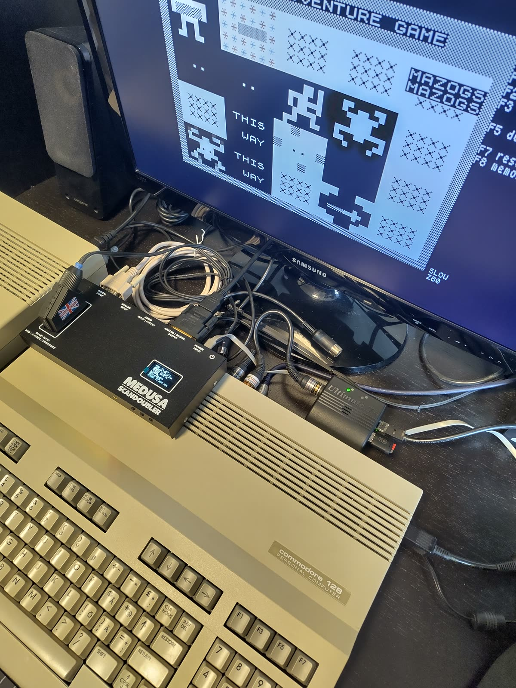
  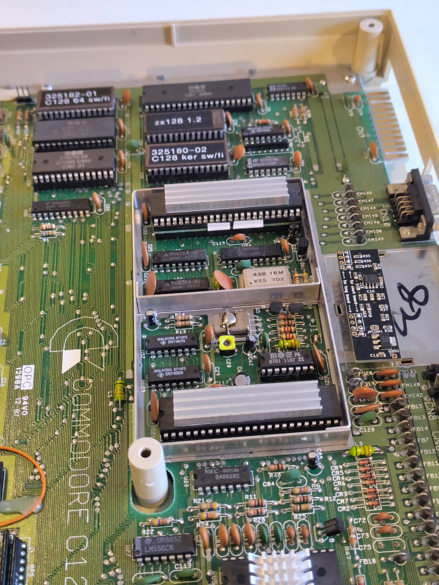
</p>

The setup, running zx128; and inside the C128: zx128 on its EPROM, the
SaRuMan-VDC under the 80-column chip, and the RF modulator replacement.

### Using it

[Using the ZX81](#using-the-zx81), [The games](#the-games), [The
monitor](#the-monitor) and [The test programs](#the-test-programs) all
hold, with these differences.

**The keys:**

<p align="center">
  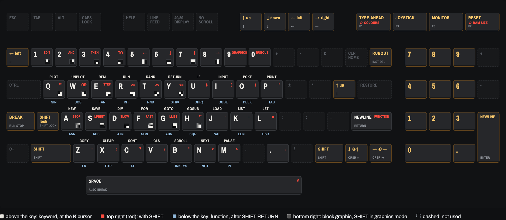
</p>

Printable overlay: [keyboard128.pdf](keyboard128.pdf). Keyboard viewer,
to open locally: `docs/keyboard.html?c128`.

**The disk.** `LOAD` and `SAVE` go through the C128's kernal, on the
drive zx128vic started from, with the loading bar on the top row.

**The monitor** has one more command, `V`: the ZX81's system variables
that say where things are in memory, such as D_FILE, VARS and RAMTOP,
and FRAMES. `V` only reads them; `:` changes one: `:4004 00 80` makes
RAMTOP `$8000`.

<p align="center">
  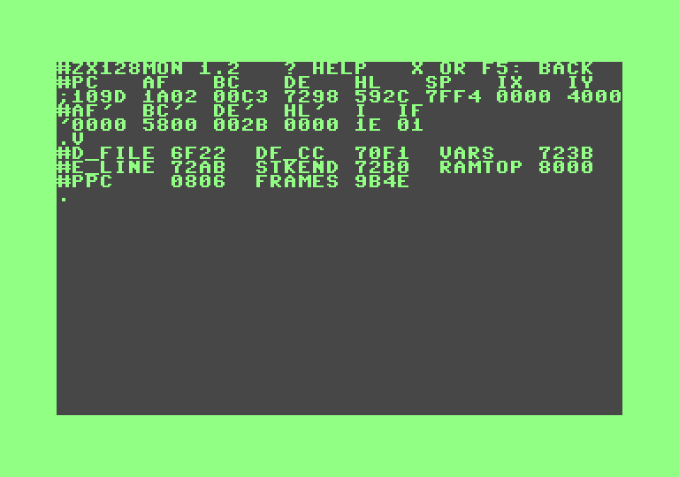
</p>

The monitor can't reach the C128's chips, such as the VIC: on the C128
the Z80 only gets at them with `IN` and `OUT`, not through memory. So
`M` and `:` only show and change RAM, and `:C020 02` doesn't make the
border red as it does on the C64. The Z80's memory:

<p align="center">
  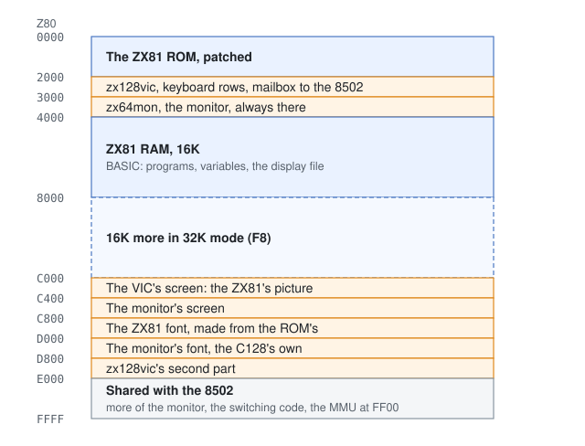
</p>

## zx128

zx128 is the ZX81 on the C128's 80-column screen, with a debugger beside
it: the build that shows off the C128. The picture is sharper than a
ZX81 ever looked on a TV, and the ZX81 runs faster than the real one.
Stop a game with F5, and step through its code while its picture
changes next to the listing.

The 40-column picture is easy: the VIC
reads its screen from the computer's own memory, so zx64 and zx128vic
just copy the ZX81's picture there. The 80-column chip, the VDC, is cut
off from the rest of the machine. Its screen is in its own memory, which
neither CPU can reach: every byte has to be handed to the chip one at a
time, waiting each time until it's ready. That's the bottleneck. Copied
that way, games would crawl. zx128 gets around it with a trick that
isn't in Commodore's documentation: see [The picture on the
VDC](#the-picture-on-the-vdc).

zx128 takes advantage of the C128 in several ways:

- **Its own Z80.** No cartridge, no wire: see [Two CPUs, one
  MMU](#two-cpus-one-mmu).
- **The 80-column screen.** The ZX81's picture keeps its shape, with room
  beside it for the panel, or for the monitor.
- **128K.** The ZX81 and the whole monitor in one half, the C128's own
  system and a spare copy of the ZX81 ROM in the other.
- **The boot sector and the function ROM:** nothing to type, or no disk
  at all. See [Starting from the function ROM](#starting-from-the-function-rom).
- **Burst loading** from a 1571: games load about five times as fast.
- **The C128's own keys:** the keypad and the cursor keys.

### Getting started with zx128

zx128 is for the C128's 80-column screen, on an RGBI display or a
converter for one. For the 40-column screen, use [zx128vic](#zx128vic).
The 80-column chip's usual memory is enough: the SaRuMan-VDC in the
setup zx128 is tested on isn't needed.

zx128 is built and started as [zx128vic](#getting-started-with-zx128vic)
is, from `build/zx128.d64`, `build/zx128.rom` or `build/zx128.crt`. It
only uses the 80-column screen. The 40-column screen just says `zx128:
the 80-column screen, please`, or stays empty with the 40/80 key down.

In VICE: `make vice128`, `make vice128rom` and `make vice128crt`.

### The screen

<p align="center">
  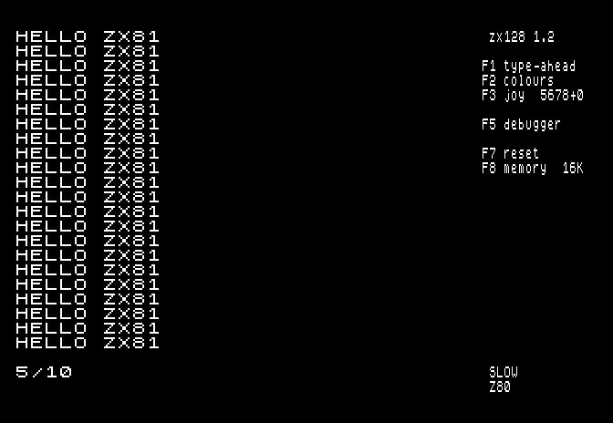
</p>

The panel's bottom rows say whether the ZX81 is in SLOW or FAST mode,
and which CPU has the machine: the Z80, or the C128's own 8502 while it
works the disk. [Using the ZX81](#using-the-zx81) and [The
games](#the-games) hold as on zx64, with the C128's keys as in
[zx128vic](#using-it), and two differences:

- **The colour schemes:** F2 has four of its own, white on black, C128
  colours, C64 colours and ZX81 colours. The background colour fills
  the whole screen.
- **The top row's messages,** the loading bar and the joystick's keys
  among them, are on the panel.

zx128 is a little slower than zx128vic, since keeping the 80-column
picture up to date costs the Z80 part of every frame. Both are still
well ahead of a real ZX81.

**F5** opens the monitor on the right, over the panel. The ZX81 moves to
the left half, its characters half as wide, and is drawn again after
every command and every step: step through a game with `S` and watch the
picture change beside the code. `X` or F5, and the picture is back at
full width. The monitor is as [zx128vic's](#using-it): always in memory,
with `V`, the keypad and the cursor keys.
[See it on the real C128](img/demo128-monitor.mp4).

<p align="center">
  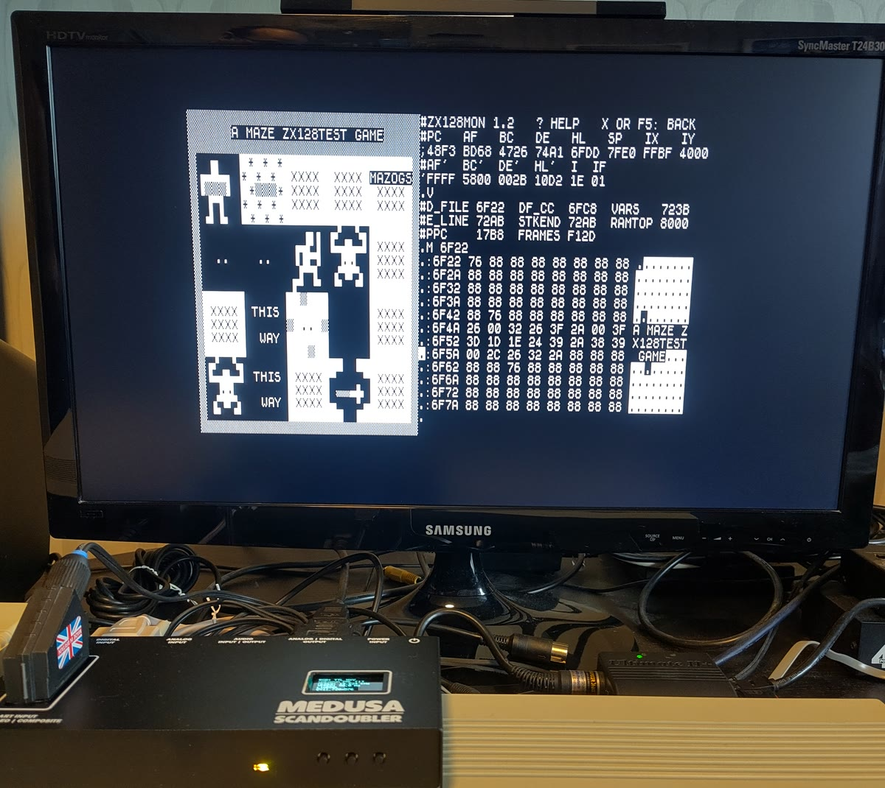
  <br><sub>The title's ADVENTURE typed over in the monitor, and the game's picture shows it.</sub>
</p>

The Z80's memory, for the monitor:

<p align="center">
  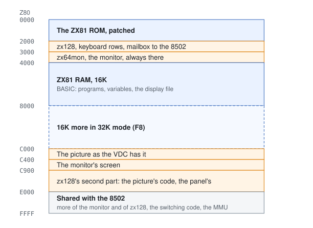
</p>

### How zx128 works

zx128 runs zx64's ZX81: the same ROM patches, and a few of its own; the
same keyboard code, type-ahead, joystick and monitor. The C128 changes
nearly everything around them.

#### Two CPUs, one MMU

The C128's Z80 and 8502 take turns, as the C64's 6510 and the
cartridge's Z80 do: one hands the machine to the other with a write to
a register, and waits until it gets it back. A handover there and back
takes a tiny fraction of a frame.

Where the cartridge simply shifts the Z80's addresses, the C128 has a
memory manager, the MMU, which decides for both CPUs what they see: RAM,
ROM or the chips. It has two catches:

- In the C128's first 64K, the Z80 finds its own small CP/M ROM where the
  ZX81 wants its ROM. So the ZX81 lives in the second 64K, and the 8502
  stays in the first with the C128's kernal.
- The MMU's setting is one for both CPUs: whatever one sets, the other
  finds when it wakes. So both switch from a small area of memory that
  every setting leaves in place, the top 8K, which both halves share.

The VIC's interrupt reaches the Z80 as it reaches the 8502, so the ZX81
gets its 50 interrupts a second with no wire.

#### The chips by IN and OUT

With all of its memory RAM, the Z80 reaches the C128's chips only by
`IN` and `OUT`. zx64's keyboard trick works here too: a game that reads
the keyboard with its own `IN` finds the keys where it expects them.
All but one row, Y to P: there the C128's `IN` reads an empty corner of
its I/O instead, as if every key in the row were held. zx128 patches the
games it knows as they load, BoulderL among them. Other games that read
that row themselves may act as if its keys were held.

The C128's own keys, the keypad and the cursor keys, are in extra
columns of its keyboard, which zx128 reads along with the C64's.

#### The picture on the VDC

The VDC's memory is out of the CPUs' reach: every byte goes in through
one of its registers, and the chip has to be asked before each one
whether it is ready. A full copy of the picture takes several frames.

Except when the VDC has drawn a frame and is going back to the top of
the screen for the next one, the vertical blank. Then it takes bytes
without being asked, several times as fast. So zx128 does three things:

- **It writes only what changed.** It keeps a copy of what the VDC
  shows, compares it with the display file, and queues the differences.
  The rows where something is likely being printed go first.
- **It writes in the blank.** The VDC has no interrupt, so zx128 uses
  the VIC's, aimed every frame at just before the VDC's blank. The two
  chips' frames differ by a hair, so the aim moves a little every frame
  to stay on it.
- **It lets the VDC do the work.** The ROM's `CLS` and `SCROLL` are
  patched to have the VDC clear or move the picture itself, with its own
  block fill and block copy.

Most of the time the picture costs the Z80 about a quarter of each frame.
Even a big redraw in Mazogs is on the screen in about a tenth of a
second.

The characters come from the VDC's own memory: the ZX81's, each split
into a left and a right half, so the picture keeps its shape; and a
narrow set for the monitor's half-width picture and the panel's text.

#### Starting from the function ROM

The C128 looks for a ROM in its internal function ROM socket, and in the
cartridge port, at every reset, and starts one it finds before the
kernal has set anything up. zx128 doesn't quite fit in a 32K ROM, so the
build packs it with Einar Saukas's [ZX0](../extras/zx0/), to about three
quarters of its size. The ROM unpacks it to where the boot sector would
have loaded it, and carries on as from the disk.

The catch: the unpacked program reaches into the memory the ROM itself
sits in. So the unpacker works in two steps, and once it no longer needs
the lower half of the ROM, it swaps that half for RAM. The build checks
that nothing is still to be read from there.

CTRL held at the start skips the ROM: the kernal goes on into C128 BASIC
as if it weren't there.

To put zx128 or zx128vic in the C128 for good, burn `build/zx128.rom`
or `build/zx128vic.rom` into a 27C256 EPROM with a programmer such as
the TL866II+. It goes in the internal function ROM socket, U36 on the
flat C128, with its notch the same way as the C128's other ROMs.
Switched on, the ZX81 is there in seconds:
[see it on the real C128](img/demo128.mp4).

<p align="center">
  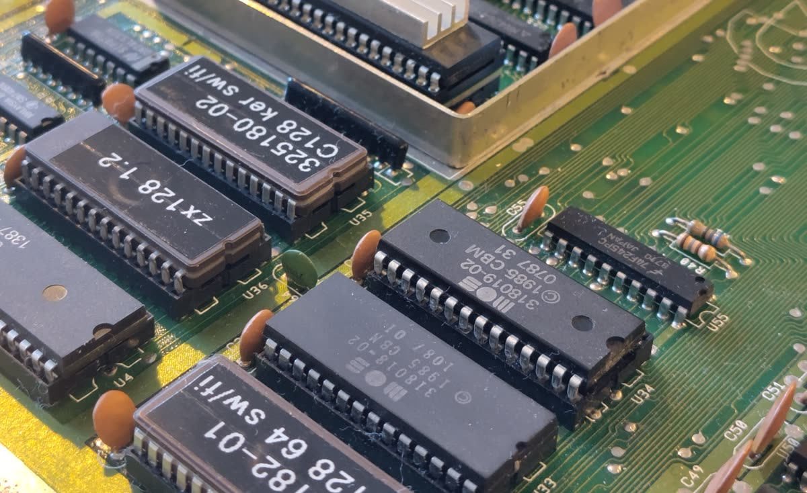
</p>

#### The disk on the C128

The 8502 does the disk, as the 6510 does on the C64, but through the
C128's kernal, which uses a 1571's fast burst mode by itself. `LOAD`
reads the whole file in one go into the 8502's half of memory and then
copies it across, which is faster even without burst. On zx128 the bar
and the messages are on the panel, which says the 8502 has the machine
meanwhile; on zx128vic, on the top row.

## Troubleshooting

- **The picture freezes while a program runs; games ignore keys.** The
  `/INT` wire is missing or loose. `SPEED` says `/INT SEEN: 0`. Push the
  cartridge fully home; half-seated, the picture freezes and keys come
  and go.
- **"NO Z80: ZX64 NEEDS THE C64 CP/M CARTRIDGE."** zx64 found no Z80:
  no cartridge, or it isn't seated.
- **"ZX64 NOT LOADED"** after `RUN`: the disk has the boot file, `ZX81`,
  but not `ZX64`, or there was a disk error. Copy zx64's four
  files from `build/zx64.d64`: `ZX81`, `ZX64`, `zx64mon` and `zx64mon2`.
- **Report D on LOAD.** The file isn't on the drive zx64 came
  from, under that name or with `.P`. `@` in the monitor shows the
  drive's message.
- **A game crashes, or F7 hangs.** It may write where it shouldn't:
  `tools/pcheck.py -v` shows its `OUT`s and where they land. F7 repairs
  the ROM, but not zx64's own code: the top row then says `ZX64 CHANGED:
  LOAD IT AGAIN`; load the boot file again.
- **"ROM NOT RELOADED: NO ZX64"** or **"OTHER ZX64"** on F7: the disk
  in the drive has no `ZX64`, or one from another version of zx64. The
  ROM stays as it is.
- **"NO ZX64MON ON THE DISK"** on F5: the files `zx64mon` and `zx64mon2`
  aren't on the drive zx64 booted from. **"ZX64MON: OTHER ZX64"**: they
  are, but from another build of zx64, which would crash; put the ones
  from this build's `build/zx64.d64` there.
- **Typing in VICE gives the wrong keys.** Set VICE's keyboard mapping
  to positional.

### On the C128

- **"zx128: the 80-column screen, please"** on the 40-column screen, or
  **"zx128vic: the 40-column screen, please"** on the 80-column one: the
  40/80 key is the other way. The build runs anyway; look at the other
  screen instead.
- **C128 BASIC instead of the ZX81.** The disk wasn't in drive 8 at the
  start, or CTRL was held: `BOOT` starts it from the disk.
- **A 1571 loads as slowly as a 1541.** The C128 didn't get burst from
  the drive. After `LOAD"$",8` in C128 BASIC, `PRINT PEEK(2588)` says
  64 with burst and 0 without. A faulty CIA chip can cause it, and
  swapping the two CIAs can fix it. An SD2IEC has no burst: it loads at
  the kernal's usual speed.
- **"ROM NOT RELOADED"** on F7: the ROM's spare copy has been changed
  too, and the disk in the drive has no `ZX128` (`ZX128VIC`),
  or one from another build, or gave an error. The ROM stays as it is.
  **"ZX128 CHANGED: LOAD IT AGAIN"** (**"ZX128VIC CHANGED"**): a program
  wrote over zx128 itself; boot it again.
- **A game acts as if a key from Y to P were held.** It reads that row
  itself, which the C128 can't give it: see [The chips by IN and
  OUT](#the-chips-by-in-and-out).

## The source

| Path | |
|---|---|
| `z80/zx64.asm` | the Z80 side: interrupts, picture, keyboard, disk via the mailbox |
| `z80/zx128.asm`, `z80/zx128vic.asm` | the same for the C128: zx128 and zx128vic |
| `z80/*.inc` | what they share: the keyboard, the ROM patches, the pictures, the panel |
| `z80/mon.asm` | zx64mon, the monitor of all three |
| `c64/boot.asm` | the 6510 side: boot, VIC setup, disk I/O |
| `c128/boot128.asm` | the 8502 side of both C128 builds |
| `c128/from.asm` | the function ROM's start: the unpacker |
| `tools/build.py` | patches the ROM, assembles, builds the d64s and ROMs |
| `tools/pcheck.py` | checks `.p` files for what won't work |
| `tools/simulate.py` | `make test`: both CPUs in emulators |
| `tools/sim128.py`, `tools/sim128vic.py` | the same for the C128 builds |
| `tools/shots.py` | this manual's screenshots, from the same emulators |
| `progs/` | the test programs |
| `scripts/` | headless VICE, for testing on Linux |
| `extras/` | tools that stand on their own: [memtest128](../extras/memtest128/), [jtest](../extras/jtest/), [ultimate.py](../extras/ultimate/), [zx0.py](../extras/zx0/), [zxbasic.py](../extras/zxbasic/) |

More: what zx64 relies on about the cartridge, with sources, in
[cpm-cart.md](cpm-cart.md); what has been tested, in
[testing.md](testing.md).
